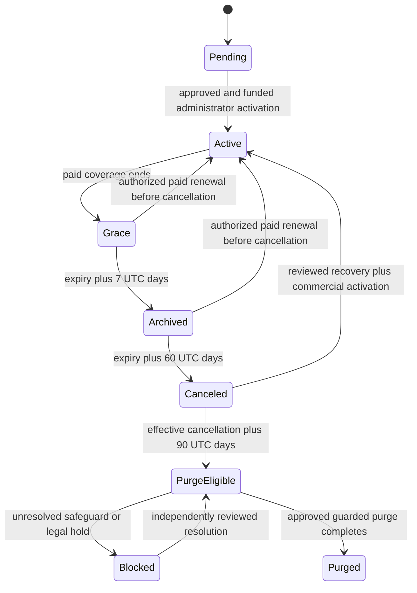

# Data lifecycle — Checkpoint A design review

9 November 2026. **Design proposal only; awaiting review. No lifecycle implementation, migration, scheduler activation, database change or deletion has been performed for this checkpoint.**

Follow-up, 9 November: the owner approved Checkpoint B with rehearsal-only enforcement and no deployed day-60 cutoff before approved export/recovery and notifications. See [Checkpoint B implementation and acceptance](data-lifecycle-checkpoint-b.md). The initial design below is retained as the reviewed proposal; C, D and E remain unapproved.

The supplied implementation brief requires: “Stop and obtain approval before making major schema or lifecycle changes.” This document satisfies that initial review gate. Approval of Checkpoint B would authorize non-destructive development and isolated migration rehearsals, not production deployment, existing-record cleanup or purge execution.

## 1. Current implementation and evidence

“Verified” below means verified in repository source, not a live deployment or signed-in browser. Historical test reports are evidence of earlier checks, not acceptance tests of this proposal.

| Capability | Current finding | Evidence |
| --- | --- | --- |
| Paid access and seven-day grace | **Verified.** An activated, non-revoked paid period permits writes until its exclusive grace deadline. | [commercial access](../src/server/commercial/access.ts#L6), [activation](../src/server/commercial/service.ts#L146), [period constraints](../prisma/migrations/20261106000200_commercial_constraints/migration.sql#L6) |
| Indefinite expired reads | **Verified defect against the new policy.** `read` does not have a cancellation cutoff. Subscription `CANCELED`/`EXPIRED` alone are not excluded by the current status predicate. | [access predicate](../src/server/commercial/access.ts#L9) |
| Archive, day-60 cancellation, retention and purge | **Not implemented.** No persisted archive/cancellation deadlines, holds, recovery/export jobs or purge ledger. Existing activation states are pending, active, suspended and closed. | [Workspace](../prisma/schema.prisma#L33), [Subscription](../prisma/schema.prisma#L282), [activation enum](../prisma/schema.prisma#L333) |
| Tenant roles and transactional writes | **Verified.** Business writes lock the workspace and recheck active membership, role and commercial access. Staff project/task scope must remain unchanged. | [authorization](../src/server/authorization/authorize.ts#L9), [policies](../src/server/authorization/policies.ts), [membership services](../src/server/services/memberships.service.ts#L20) |
| Payment and renewal | **Verified.** Independent receipt verification and SUPER_ADMIN activation create an immutable paid period. Activation extends early renewals and uses the current time for late renewals. It currently has no separate post-cancellation recovery gate. | [activation transaction](../src/server/commercial/service.ts#L146), [status administration](../src/server/commercial/service.ts#L204) |
| Platform security | **Verified in code.** Central host, active database-backed administrator, role and actual MFA factor/reverification evidence are required. Platform authority does not confer tenant business access. | [platform authorization](../src/server/commercial/platform-auth.ts#L13) |
| Audit storage | **Verified.** Tenant audit actors may be null; platform audit actors must be real administrators. Commercial update-immutability triggers protect historical quotes, periods, receipts, reversals and platform audit events. These triggers do not establish universal DELETE protection. | [AuditLog](../prisma/schema.prisma#L243), [PlatformAuditEvent](../prisma/schema.prisma#L405), [triggers](../prisma/migrations/20261106000200_commercial_constraints/migration.sql#L13) |
| Restricted navigation | **Verified.** The tenant layout redirects denied business access to Subscription without looping, and preserves central Account/Workspaces navigation. It has no canceled recovery/export experience. | [workspace layout](../src/app/w/[workspaceSlug]/layout.tsx#L24), [host route policy](../src/lib/routing/request-plan.ts#L10) |
| Global identity | **Verified.** Clerk external ID binds a global user; conflicting email bindings are rejected. User and legal-acceptance records are not tenant-owned deletion targets. | [provisioning](../src/server/auth/get-current-user.ts#L11), [User](../prisma/schema.prisma#L14), [LegalAcceptance](../prisma/schema.prisma#L317) |
| Export, delivery and restore reconciliation | **Not implemented.** No complete customer export, lifecycle email delivery or restore deletion-ledger reconciliation was found. Manual invitation links are not an email-delivery system. | [acceptance gaps](subscription-acceptance.md#L76), [invitation creation](../src/server/services/memberships.service.ts#L51) |
| Backups | **Partially verified.** Earlier reports document protected local dump files and restoration rehearsals. Current provider retention, encryption, operator access, PITR and off-host durability **require external confirmation**. No archive was opened, replaced or deleted in this checkpoint. | [backup evidence](fresh-deployment-paystack-vat.md#L17), [historical rehearsal](subscription-acceptance.md#L20) |

## 2. State and time model

Keep three dimensions separate:

1. **Commercial:** existing subscription, request, verified receipts and immutable paid periods remain authoritative. No duplicate payment or subscription system.
2. **Operational:** one central resolver calculates pending, active, grace, archived or canceled access. Existing manual suspension/closure independently override access. Purged operational data cannot be reactivated.
3. **Retention:** not started, retaining, eligible, blocked or completed. Canceled access and retention coexist; retention is not a second commercial subscription status.

Let `E` be the end of the latest applicable, activated, non-revoked paid coverage. Existing early-renewal periods must be considered so continuous paid coverage is not mistaken for expiration. A submitted request, payment claim or verified receipt without authorized activation never extends `E`.

Use UTC calendar-day addition, preserving UTC time of day and milliseconds. Never round to client-local midnight. Treat stored Prisma timestamps consistently as UTC instants; use a server/database clock captured after the workspace lock for decisions. Existing month/annual paid-period arithmetic and immutable grace deadlines remain intact.

| Effective interval | Operational state | Retention state | Allowed activity |
| --- | --- | --- | --- |
| Before `E` | ACTIVE | Not started | Existing subscribed role/assignment permissions |
| `E <= now < E + 7 days` | GRACE | Not started | Existing grace permissions |
| `E + 7 <= now < E + 60 days` | ARCHIVED | Not started | Existing role-filtered reads; verified owner renewal/export; account/support |
| `E + 60 <= now < E + 150 days` | CANCELED | Retaining | No normal business reads/writes; reviewed central recovery/export only |
| `now >= E + 150 days` | CANCELED | Eligible or blocked | Purge only after all independent safeguards; eligibility never means automatic deletion |

Automatic cancellation is effective at `E + 60`, including grace. Retention ends 90 days after that effective date. If a worker first observes it on day 80, it records day 60 as effective cancellation and day 80 as observation; it does not restart the retention clock. The exact deadline belongs to the later state. Notifications/export availability remain separate purge prerequisites, so late processing cannot justify deleting data without those protections.

The diagram combines operational and retention milestones for readability; they are separate domain values. Manual suspension, closure, payment reversal and legal hold are independent restrictions. A scheduler must never lift them. A hold preserves data, not operational access. Pending workspaces without any paid period do not acquire an invented expiration date; abandonment policy for them needs a separate decision.

Customer-requested cancellation will have a separately recorded request, confirmed effective date and review. Refund rights, paid-period access and an immediate-cancellation option are not inferred from the automatic-expiration policy.

## 3. Proposed schema, in staged additions

Use existing Workspace IDs, subscriptions, periods and audit tables. Add the following records only when their checkpoint is implemented. Names are proposed, not generated Prisma models yet.

| Record | Minimum responsibilities and fields | Stage |
| --- | --- | --- |
| `WorkspaceLifecycle` | One per workspace; policy version, revision, source paid-period reference, archive timestamp, effective/recorded cancellation timestamps, cancellation source/reason/actor reference, retention deadline, purge completion, indexed next evaluation. An episode identifier separates a recovered workspace's later expiration from prior history. | B |
| `WorkspaceCancellationRequest` | Workspace/requester, idempotency key and payload hash, proposed effective date, confirmation and review status/timestamps/actors, bounded reason. A request is not cancellation or refund approval. | B |
| `LifecycleJobRun` | Run identity, dry-run flag, bounded batch cursor, counters, sanitized failure codes and times. No customer payloads. | B |
| `WorkspaceRecoveryRequest` | Requester identity, workspace, authority evidence references, review decision/reason, scoped grant and expiry. Recovery approval does not itself activate a subscription. | C |
| `WorkspaceExportRequest` | Requester and optional reviewed recovery grant; scope/schema version, idempotency, state, lease, expiry, token hash if needed, row/byte counts, digest and completion/failure metadata. No permanent public archive URL. | C |
| `RetentionRestriction` | Multiple category-scoped legal holds or exceptions; authority, basis/policy reference, start, expiry/review date and audited release. Avoid a single irreversible blanket hold boolean. | D |
| `WorkspacePurgeOperation` | Stable operation ID, workspace/episode/policy, eligibility decision, approved category manifest, resumable stage/cursor, lease, error code, completion and external-ledger acknowledgement. Local deletion journal and job are one record. | D |
| `LifecycleNotice` | Notice kind and deadline, recipient authority reference, required delivery status, provider evidence or explicitly reviewed alternative, deduplication key and timestamps. Recording a notice is not evidence that it was sent. | C/D |

Reuse tenant `AuditLog` for system events with a null user actor and bounded metadata: episode, transition, policy, effective time, observed time and operation ID. Human administrator decisions additionally use existing `PlatformAuditEvent`; never invent a platform administrator for cron. Add a unique nullable operation key to audit events, or equivalent database uniqueness, so retrying a transition cannot create duplicate event history. Audit and state commit in the same transaction.

Store historical ownership authority needed for cancellation/recovery as a minimal event/snapshot tied to the episode. It is review evidence, not an automatic access grant to removed or suspended owners. Preserve global users and account-level legal receipts; separately classify unnecessary workspace membership/job-title/profile copies.

### Constraints and indexes

- One lifecycle row per workspace; compound workspace/period and workspace/request references wherever a record references tenant-owned data.
- Unique workspace/episode/operation keys; payload mismatch on key reuse fails. One active export or purge operation of a given kind per workspace, using partial unique indexes where appropriate.
- Index effective cancellation, next evaluation, retention deadlines, pending jobs and restriction review deadlines. Bounded candidate selection must use these indexes.
- Enforce deadline ordering and the versioned 60/90-day automatic policy, valid lease/deadline relationships and finalized decision immutability. Do not apply automatic-cancellation formulas to separately approved early cancellations.
- No broad new cascades. Review existing Restrict relationships before any deletion or anonymization. Paid periods, receipt/reversal evidence and quote snapshots must not be rewritten to make deletion easier.
- A minimal workspace tombstone may remain where lawful retained records require its foreign key. Its name, slug, invitations, free text and personal metadata must each be classified; keeping the whole workspace row indefinitely is not anonymization.
- Address reuse after purge needs an explicit retired-address policy to prevent tenant impersonation. A minimal opaque or keyed reservation is preferable to retaining a personal business name indefinitely; key management and reservation duration need review.

Do not add ARCHIVED to commercial statuses merely to drive the UI. Keep existing activationStatus for manual administrative control and calculate lifecycle access through the resolver. If CANCELED is materialized on Subscription, all activation/status writers must use the same lifecycle transaction rules.

## 4. Central service and concurrency rules

Add a pure UTC policy calculator and a server-only lifecycle service. All current commercial reads/writes call the effective resolver rather than trusting a cron-maintained enum. It must deny day-60 business access even if no scheduler has run. Persisted markers support audit/history and scheduling, not independent authorization.

Use the existing Workspace row lock for lifecycle transitions, subscription activation, cancellation confirmation, recovery decisions, export reservation and each purge batch. Recheck current identity, role, workspace, paid period and lifecycle after acquiring it. Preserve current lock ordering with PlatformAdmin rechecks. Use bounded leases and compare-and-set progress for workers; a lease alone is not authority.

Specific races to resolve:

- **Renewal/cancellation:** before the effective cutoff a valid administrator activation can extend coverage. At or after it, activation must require reviewed recovery even if cancellation has not yet been materialized. A pending or merely funded request cannot restore access.
- **Manual administration:** `setWorkspaceStatus(ACTIVE)` must not bypass cancellation or recovery. Suspension/closure and payment reversals retain their independent restrictions.
- **Exports/purge:** a valid export lease blocks deletion. Export authorization is checked at request and download. Purge rechecks each batch, so a newly recorded hold or recovery review stops further destruction. Once deletion starts, automatic reactivation is prohibited; reviewed recovery must assess already deleted categories.
- **Requests/holds:** creating or releasing restrictions uses the same lock. Failed audit writes roll back decisions. A stale unresolved commercial/recovery case blocks purge until an authorized, audited disposition; it does not grant operations.
- **Delayed/repeated processing:** transition keys include the episode and effective deadline. Record missing milestones once, in order, with their original effective dates. Dry-run reports intended changes without changing customer state.

Archive preserves OWNER/MANAGER/STAFF read filters and assignment checks. No client contacts, budgets or invoices become visible to staff. Business, member and invitation writes remain denied. Owner subscription/export/security paths are explicit exceptions, not blanket commercial bypasses.

## 5. Export and recovery design for Checkpoint C

Provide central `/account` recovery/export pages and protected handlers, reachable without a normal tenant dashboard. Actual paths must be added narrowly to host routing and tested; no wildcard origin allowance or tenant header can confer authority.

Full export requires a live verified Clerk identity, current verified OWNER authority or an unexpired reviewed grant, lifecycle permission and recent step-up. Proposed sensitive-export policy is MFA-backed step-up; owners who cannot complete it use reviewed recovery rather than a weak email-only bypass. Confirm this product/security decision before C. Manager/staff cannot request a full financial export. Platform roles review requests but do not automatically download customer content.

Export documented JSON and CSV in ZIP: workspace business details, clients, projects, assignments, tasks and customer invoices with stable IDs. Include only member fields and customer-owned audit events needed to interpret relationships. Exclude other tenants, authentication/external identity IDs, invitation tokens/hashes, internal platform notes/audits, provider credentials and unrelated platform payment records. No attachment functionality exists to export today; reassess at implementation.

Start with bounded authenticated generation, not a public artifact store: paged reads from a consistent, bounded snapshot; an export lease protects against purge; byte/row/time/concurrency caps prevent oversized requests. Do not hold a Workspace write lock while streaming across the network. Downloads recheck authorization and use private/no-store cache headers. CSV must neutralize spreadsheet formula injection without corrupting the documented JSON source. Failures produce no claimed successful complete export.

If representative customer volumes exceed safe snapshot/function limits, C cannot pass with an unusable export: use an approved private artifact store and worker with encrypted temporary files, short TTLs, revocation, cleanup and access logs. This infrastructure does not currently exist. Temporary access tokens, if required, are hashed, short-lived, bound to the requester and never a substitute for session authorization. Avoid token-bearing public/logged URLs.

Recovery must verify historical authority, handle lost/suspended membership explicitly and record reviewer, scope and expiry. No email collision rebinding or transfer of global identities. Post-cancellation reactivation still requires existing payment verification and SUPER_ADMIN activation through the single activation service.

## 6. Retention, purge and restoration safety

| Category | Proposed handling | Decision before destructive implementation |
| --- | --- | --- |
| Client/project/task data, operational associations and customer invoices | Eligible after the 90-day retention deadline, except a documented applicable hold/obligation | Confirm customer invoice obligations and export schema |
| Subscription quotes, payments, receipts, reversals and tax evidence | Category-specific retention, access restriction and minimization | Legal/accounting basis, exact duration, start event and permitted redactions; no invented duration or indefinite default |
| Security/audit, dispute and recovery evidence | Purpose-limited exception with review/expiry and minimal identity | Security/legal retention schedule and hold/release authority |
| Global user and legal acceptance | Outside tenant purge; retain only under a separately approved account/legal policy | Account deletion, shared memberships and legal evidence schedule |
| Backups, restored copies, temporary exports and logs | Separate schedules and access controls | Actual provider retention, encryption, expiry, restore reconciliation and artifact cleanup evidence |

Deletion remains disabled by default behind a deployment control, independent of non-destructive processing. A manual retry cannot override it or skip eligibility. Recheck authoritative deadlines, source coverage, restrictions, recovery/commercial cases, export availability, required notice evidence and prior completion before each bounded batch. Missing approvals/evidence fail closed.

Use an explicit dependency manifest: operational task/assignment relationships, customer invoices as legally classified, projects, clients, invitations and redundant workspace associations. Existing compound Restrict foreign keys mean the exact order must be proven on populated fixtures. Keep required financial links valid. Audit free text and metadata for personal information too. Never delete User records, unrelated memberships or global legal evidence as a consequence of workspace purge.

A deletion journal in the same database is insufficient: restoring an older backup restores an older journal. Before destruction, mirror a minimal intent to an independently durable, append-only ledger outside the application's restore boundary. Record opaque workspace/operation IDs, policy/category manifest, times and acknowledgements, not deleted customer content. Mirror batch progress and completion; if durability cannot be confirmed, stop. Idempotent intents make a crash between ledger acknowledgement and database commit recoverable.

Every restored environment starts quarantined. Reconcile against the independent ledger and reapply completed/in-progress deletion obligations before reads, exports, activation or scheduled processing are released. Record a database-instance reconciliation attestation tied to the trusted ledger watermark. Do not rely solely on a restorable environment flag. The external ledger provider, permissions and restore admission mechanism require separate infrastructure review before D acceptance.

No existing backup will be overwritten or deleted. Local historical dumps are documented in [fresh-deployment evidence](fresh-deployment-paystack-vat.md#L17); current Neon/Vercel backup, log retention, encryption and operator permissions require external confirmation. If immutable backups cannot be edited, document their actual expiration schedule, restricted use and mandatory reconciliation. Operational deletion is not proof of deletion from backups.

## 7. Scheduling, notices and administration

**Assessment:** bounded Vercel Cron invocations are a reasonable initial trigger; a separate worker is not justified until measured runtime/volume requires one. Cron functions need application locking, idempotency and failure monitoring. Vercel documents `CRON_SECRET` authentication, duration limits, overlapping/duplicate executions and failure handling; platform scheduling alone is not a deadline or mutual-exclusion guarantee. See [Vercel managing cron jobs](https://vercel.com/docs/schedules/cron-jobs/manage-cron-jobs) and [Cron overview](https://vercel.com/docs/schedules/cron-jobs), reviewed 9 November 2026. Actual account limits and deployed behavior remain unverified.

Use separate non-destructive and purge handlers, narrow central-host route allowances, a strong server-only bearer secret, strict missing-secret failure, no public cache, bounded indexed batches, leases and run records. Never authenticate by User-Agent or an arbitrary workspace parameter. An explicitly permitted machine path must avoid Clerk interactive redirects while retaining independent secret authorization. Test both routing and handler enforcement. No `vercel.json` schedule is activated in this checkpoint; preview tests use explicit authenticated invocations against isolated fixtures.

Proposed controls for later review: `COREOPS_LIFECYCLE_PROCESSING_ENABLED` and `COREOPS_PURGE_ENABLED`, both initially false, plus `CRON_SECRET` and configured batch/time limits. Names are a proposal, not currently supported settings. Purge additionally requires policy, notice, export, legal and restore-ledger readiness, not merely an environment toggle.

There is no implemented lifecycle email sender. Design notices for upcoming expiry, grace, archival, impending cancellation, cancellation, approaching retention end and completion. Existing 14/7-day expiry reminders remain a delivery gap. Decide other lead times, delivery/retry rules and approved alternatives before claiming notifications. A notice row/UI banner must not be labeled “email sent”; missing required pre-deletion notice evidence blocks purge.

Platform UI: lifecycle/deadline directory, failures, restricted recovery/exception queues, export metadata, purge ledger and bounded retry. Preserve Support's redacted directory/audit access and Billing's commercial scope. Proposed new sensitive lifecycle review/hold-release/recovery/purge-retry permissions are SUPER_ADMIN-only with existing MFA and an audit reason; legal authority still requires documented evidence. No new public admin registration or generic delete button.

## 8. Migration and rollback plan

1. Approve this state model and B scope. Prepare forward-only additive Prisma/SQL migrations; never edit applied migration history. B adds only its required records/indexes/constraints. Existing records are not deleted or assigned invented historical cancellation dates.
2. Inventory target schema/periods/overrides read-only and produce a dry-run impact report. Historical deadlines can be calculated, but enabling them may immediately restrict old expired tenants. Obtain environment-specific rollout approval; disposable local data is not permission to purge it.
3. Take/validate a protected backup before an authorized target migration. Preserve all existing archives. Create a dedicated guarded lifecycle rehearsal database, migrate from empty and from a restored populated fixture set; never use the normal application/production database for lifecycle deletion tests.
4. Rehearse the entire migration chain and schema diff, plus explicit raw SQL constraints/indexes not covered by Prisma diff. Compare pre/post business, identity, assignment and financial fingerprints. Exercise recovery/rollback on the isolated copy.
5. Use an expand-first rollout with processing off. Resolve absent lifecycle rows safely from existing authoritative coverage; do not grant access because a row is absent. Materialize an episode only transactionally. Any backfill must be reviewed separately from migration DDL.
6. Enable non-destructive enforcement/jobs only after B evidence and operator approval in the target environment. C/D get separate migrations and gates. Production remains outside this task's authorization.

Before destructive execution, rollback is forward-fix or disabling workers with an authorization-compatible application version. An old build that restores indefinite reads is not a safe rollback after canceled access is enforced. Do not drop populated lifecycle/audit tables or erase cancellation history to roll back. After a purge, rollback cannot recreate destroyed data by reversing a migration; restoring a backup requires quarantine and ledger reconciliation and must not silently undo deletion obligations. Disable workers, preserve evidence, and make any recovery decision explicitly.

## 9. Affected files and staged delivery

| Checkpoint | Planned changes | Required evidence / exit |
| --- | --- | --- |
| B — non-destructive | `prisma/schema.prisma`, new forward migrations; new `src/server/lifecycle/{policy,service,scheduler}.ts`; `src/server/commercial/{access,service}.ts`; auth/authorization integration; tenant layout/subscription state UI; narrowly scoped cron handler and routing policy | Exact UTC boundaries; delayed/repeated jobs; role-preserving archive reads; canceled denial; renewal/cancel races; reversal/suspension/closed compatibility; audit rollback. Report and review before C. No purge. |
| C — export/recovery | New central account export/recovery pages/actions/handlers; lifecycle export/recovery services; permission registry; host/return/navigation guards; request/notice schema | Live identity + step-up boundaries, historical ownership review, full schema and sensitive-field inspection, cross-tenant denial, role denial, bounded downloads, revocation, export/purge exclusion. Real signed-in browser acceptance remains separate from mocked tests. |
| D — disabled deletion | Restriction/purge/notice models and constraints; category classifier, resumable deletion, independent ledger adapter, restore quarantine/reconciliation, restricted platform review/retry pages | Disposable fixture deletion only; every fail-closed gate; interruption/resume; holds/races; foreign-key integrity; shared global user preservation; pre-journal backup restore drill. Deployment purge remains disabled. |
| E — readiness | Operator runbooks, environment/scheduler/migration instructions, legal retention schedule, provider/notification evidence and acceptance report | Exact test commands/results, actual signed-in security evidence, backup/restore confirmation and unresolved blockers. No automatic deployment or activation. |

Extend existing `tests/authorization.integration.cjs`, `commercial.integration.cjs`, `identity.integration.cjs`, `paystack-vat.integration.cjs`, `proxy.test.cjs` and host/navigation regressions; add focused lifecycle/export/restore tests. Use real PostgreSQL with clearly identified substituted Clerk/provider boundaries. Do not weaken existing assertions. Run installed repository typecheck, lint, applicable unit/integration scripts, Prisma generation/migration validation/diff and production build at the implementation checkpoints.

Boundary tests must cover exact expiry/7/60/150-day instants, leap/year/month changes, different client time zones, early/late renewals, future activated coverage, unverified/unactivated money, stale workers, concurrent cancellation/export/hold/purge, audit rollback and idempotency. Restore tests must use a backup older than the deletion intent to prove the independent ledger is necessary. Test both direct services and route/Server Action boundaries; a mocked Clerk success is not browser acceptance.

## 10. Decisions and launch blockers

| Priority | Decision or risk | Required resolution |
| --- | --- | --- |
| P0 | No current customer export/recovery or purge-safe restore system | Complete C and D security acceptance before any deletion is enabled |
| P0 | Financial/legal exception durations are unspecified | Legal/accounting approval per category, basis, starting event, duration and release authority; unresolved categories block destructive processing |
| P0 | Independent ledger/storage and restore admission are unconfigured | Approve infrastructure and demonstrate restoration cannot serve deleted records |
| P0 | Required lifecycle notice delivery is unavailable | Approve timing/channel, configure delivery/evidence and retries, or review a lawful explicit alternative; no silent bypass |
| P1 | Customer early cancellation/refunds and paid-period treatment | Confirm effective-date/refund policy; support request/review only until settled |
| P1 | Export step-up and lost-owner recovery authority | Approve recent-MFA policy and reviewed alternative, evidence requirements, reviewers and grant lifetime |
| P1 | Suspended/closed tenants, never-paid abandoned workspaces | Confirm retention start policy for these distinct cases. Preserve access restrictions and block ambiguous purge; do not invent expiry |
| P1 | Retired tenant addresses and minimized tombstones | Decide reservation policy, lawful retention and possible anonymization compatible with immutable financial evidence |
| P1 | Preview/prod backup settings, real Clerk MFA and operator sessions | External account confirmation and signed-in acceptance; repository tests cannot certify them |
| P1 | Data volume versus export/function limits | Measure representative fixtures; provide usable bounded export before retention enforcement can lead to purge |

### Review requested

Approve the proposed automatic-expiration state model, additive B schema scope and transactional non-destructive implementation as Checkpoint B. The remaining legal/infrastructure decisions above can remain explicit blockers for C/D/E; they do not authorize invented policies or destructive defaults. This approval would not authorize production migration, scheduler deployment, changing legal documents, deleting existing records, or enabling purge.

### Verification of this checkpoint

Repository inspection and official scheduler documentation review only. No database connection or provider configuration change was needed. No tests/build/migration commands were run for this design-only addition; earlier acceptance reports do not verify new lifecycle behavior. Existing Clerk-readiness working-tree changes were left untouched.
