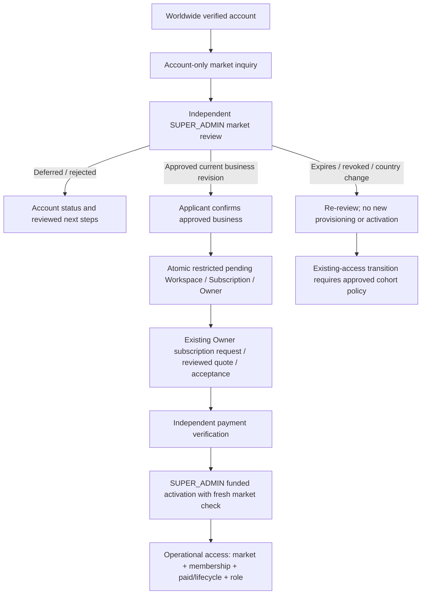

# P-C2F — Market eligibility and subscription inquiry design

**Internal Working Draft — Founder Business Policy, Pending Legal and Operational Verification**

11 November 2026. **Architecture/requirements proposal only. No implementation or release approval.** Stravect Systems is a Kenyan sole proprietorship as represented by the founder; proprietor particulars remain unverified. P-C2B is accepted for internal legal-review preparation only. This report does not decide legal market eligibility or certify an operating control.

## 1. Recommendation and authority boundary

Introduce an account-owned business inquiry before workspace creation and a durable, independently reviewed market decision bound to that business/workspace. Require current eligibility at provisioning, paid activation, administrative restoration and every operational read/write boundary. Preserve existing Clerk verification, membership/ownership, funding, quote, capacity, MFA, suspension, reversal and lifecycle controls as separate requirements.

Approved policy: Kenya-first commercial availability, worldwide registration and international inquiries, with no international **operational** workspace creation/access until independently approved. A user country declaration, Kenyan currency, payment, identity verification or Owner role cannot approve a market. Proposed initial implementation uses **manual SUPER_ADMIN review for Kenya as well as international businesses**; no automatic country allowlist until independently approved rules/evidence exist.

Proposed timing: inquiry creates no Workspace/Subscription/Owner. After market approval and explicit applicant confirmation, create a **restricted PENDING_ACTIVATION workspace** solely to use the existing subscription workflow. No business records or operational access until separately funded SUPER_ADMIN activation. Founder must confirm this distinction: if the policy instead prohibits *any Workspace row* until both market and subscription approval, the existing workspace-bound billing model needs a separately reviewed pre-workspace quote/payment architecture. Do not silently loosen policy to fit the schema. This design recommends the restricted pending step as the smaller compatibility change, conditional on that decision.

One market case represents one proposed business and can bind to at most one workspace. Eligibility is neither global to a User nor transferable by an inquiry ID. A shared user can participate in multiple independently eligible workspaces; another user's country does not change the business's decision. Existing creation limits and ownership acquisition remain separate founder decisions; no general multi-workspace ownership expansion is implied.

## 2. Current state and complete inspected path inventory

Inspection covered application source, scripts/seed and migration definitions; no database/customer/provider inspection or command execution against them. Generated ORM APIs describe capability but are not application entry points. Privileged SQL/provider/backup operators remain a separate trust boundary; application checks cannot make a database owner obey policy.

| Current path | Source evidence / behavior | Market gap and target requirement |
| --- | --- | --- |
| Account registration/provisioning | [Sign-up](</home/rmuya/rhoda-work/coreops_dashboard/src/app/(auth)/sign-up/[[...signup]]/page.tsx:13>), [User provisioning](/home/rmuya/rhoda-work/coreops_dashboard/src/server/auth/get-current-user.ts:10): registration readiness/legal requirements, live Clerk identity, verified email, conflict-safe external-ID binding; then local User. | No market decision. Keep worldwide account access distinct from operational entitlement; never auto-rebind identity from inquiry email. |
| First-workspace page/action/service | [Page](</home/rmuya/rhoda-work/coreops_dashboard/src/app/(onboarding)/onboarding/page.tsx:10>), [action](/home/rmuya/rhoda-work/coreops_dashboard/src/features/workspaces/actions/create-workspace.ts:10), [service](/home/rmuya/rhoda-work/coreops_dashboard/src/server/services/workspace-onboarding.service.ts:24). Any existing ACTIVE membership redirects/returns an existing workspace. Otherwise User-row lock, Workspace + pending Subscription + Owner + audit in one transaction; slug collisions retry up to five times. | No country/market gate. Protect service, not just page. Existing-member shortcut must not create/return a foreign case's workspace or suggest eligibility. Each retry rechecks current decision; no stale approval captured outside transaction. |
| Workspace selection/continuations | [Dashboard](/home/rmuya/rhoda-work/coreops_dashboard/src/app/dashboard/page.tsx:8), [selection](/home/rmuya/rhoda-work/coreops_dashboard/src/features/workspaces/actions/select-workspace.ts:8), [membership](/home/rmuya/rhoda-work/coreops_dashboard/src/server/auth/get-current-workspace.ts:14). Membership authorizes selection, cookie/slug navigation is not entitlement. | Account-only inquiry must work with zero memberships and for shared users without redirect loops. Selection can show restricted shell; operational data still gated server-side. |
| Subscription request/quote/acceptance | [submitRequest](/home/rmuya/rhoda-work/coreops_dashboard/src/server/commercial/service.ts:53), review/accept functions in same service. Owner transaction locks Workspace/rechecks active Owner; request keys/hash and typed INITIAL/RENEWAL/UPGRADE; snapshots and approved offers/tax. | Requests require a workspace today. A new account-only inquiry must not pretend to be SubscriptionRequest. After approved provisioning, preserve these functions plus market rechecks. |
| Manual payment and verification | [submitPayment / verifyPayment](/home/rmuya/rhoda-work/coreops_dashboard/src/server/commercial/service.ts:99): accepted quote, receiving account, claim; independent billing-admin verification, immutable receipt, available funding determines READY_FOR_ACTIVATION. | Funding is not market authority. Block new payment solicitation if ineligible, but preserve ability to record/reconcile money already received. No automatic refund invented. |
| Paystack initialization/reconciliation/webhook | [initializePaystack](/home/rmuya/rhoda-work/coreops_dashboard/src/server/payments/paystack.ts:19), [receipt persistence](/home/rmuya/rhoda-work/coreops_dashboard/src/server/payments/paystack.ts:70); verified server-side payment facts can mark request ready. No Workspace activation or paid-period creation found in this path. | Gate new checkout attempts; callbacks/reconciliation must still record actual money after expiry/revocation without granting access. Do not hold a DB transaction over provider I/O or claim to revoke an external checkout already opened. |
| Funded paid activation, including renewals/upgrades/recovery | [activateSubscription](/home/rmuya/rhoda-work/coreops_dashboard/src/server/commercial/service.ts:150), exposed through [platform action](</home/rmuya/rhoda-work/coreops_dashboard/src/app/platform/(protected)/actions.ts:21>). SUPER_ADMIN/recent MFA, ownership verification, workspace/admin transaction locks, quote/funding/capacity checks; immutable period + ACTIVE workspace/subscription + audit. Replayed request returns existing period both before and inside transaction. | Add market gate before any new period/ACTIVE mutation and before returning actionable success. A replay may report historical activation, but must not claim current access or re-run a transition when now ineligible. |
| Administrative paid restoration | [setWorkspaceStatus](/home/rmuya/rhoda-work/coreops_dashboard/src/server/commercial/service.ts:214), platform status action. ACTIVE allowed only for existing eligible paid period/verified Owner and lifecycle check; pending/closed rejected. | This is a separate ACTIVE path and must recheck market eligibility. No generic “activate anyway” override. SUSPENDED/CLOSED restriction actions remain available to authorized administrators. |
| Cancellation recovery/restoration | [reviewRecovery](/home/rmuya/rhoda-work/coreops_dashboard/src/server/data-access/recovery.ts:35), [renewal guard](/home/rmuya/rhoda-work/coreops_dashboard/src/server/lifecycle/service.ts:21), [restoreAfterPaidActivation](/home/rmuya/rhoda-work/coreops_dashboard/src/server/data-access/restore.ts:8). Isolated grant review does not activate; restoration occurs inside funded activation. | Recovery of identity/authority never approves a market. Reactivation grant AND current market decision AND commercial requirements needed; stale grant cannot override revocation. |
| Operational read/write and membership/invitation paths | [commercialAccess](/home/rmuya/rhoda-work/coreops_dashboard/src/server/commercial/access.ts:8), [authorization](/home/rmuya/rhoda-work/coreops_dashboard/src/server/authorization/authorize.ts:9), [service scopes](/home/rmuya/rhoda-work/coreops_dashboard/src/server/authorization/policies.ts:4), [membership service](/home/rmuya/rhoda-work/coreops_dashboard/src/server/services/memberships.service.ts:14), [tenant layout](/home/rmuya/rhoda-work/coreops_dashboard/src/app/w/[workspaceSlug]/layout.tsx:24). Business services use commercial permissions or operational membership; writes recheck under Workspace lock. | Include eligibility in central operational entitlement; revalidate all direct services/RSC/actions/APIs, not only layout. Invitation acceptance and capacity helpers inherit write gate; membership/assignment scopes unchanged. |
| Lifecycle and notification workers | [lifecycle service](/home/rmuya/rhoda-work/coreops_dashboard/src/server/lifecycle/service.ts:39), [scheduler](/home/rmuya/rhoda-work/coreops_dashboard/src/server/lifecycle/scheduler.ts), [notification relevance](/home/rmuya/rhoda-work/coreops_dashboard/src/server/notifications/recipients.ts). Lifecycle materializes archive/cancel; notifications do not fund/activate a workspace. Both retain rehearsal restrictions. | No background market approval/activation found. Workers must never synthesize eligibility from payment/event/status. Preserve reconciliation/cleanup, but stale “workspace ready” relevance must include market state in later approved integration. No messages added here. |
| Reversal and restriction | [reverseReceipt](/home/rmuya/rhoda-work/coreops_dashboard/src/server/commercial/service.ts:195) revokes applicable paid period/suspends workspace; no market approval. | Market approval cannot undo financial reversal, suspension/closure or lifecycle denial. Preserve actual funding evidence and separate restriction reasons. |
| Seed, synthetic fixtures and restores | [seed upsert](/home/rmuya/rhoda-work/coreops_dashboard/prisma/seed.ts:29) creates demo Workspace/Owner and writes demo operational records; [preservation fixture](/home/rmuya/rhoda-work/coreops_dashboard/scripts/notification-preservation-fixtures.cjs:7) directly creates synthetic ACTIVE/paid records in guarded isolated DB. Historical migrations provide schema/backfill, not inquiry authority. | These bypass application services by design. Do not run seed/fixtures on a shared target; future fixtures need synthetic market records. Target migration/restore runbooks must not infer approval from ACTIVE/paid status or create historical approvals. No approved operational admin-create/import endpoint beyond inspected paths found. |

Current Workspace has no business-country/market decision linkage ([schema](/home/rmuya/rhoda-work/coreops_dashboard/prisma/schema.prisma:37)). No independently approved eligibility field or service was found. No international customer existence, country, eligibility or legal compliance is inferred from this gap.

**Before a workspace exists today:** sign-in/account/legal/help and published offer information can operate account-side; membership-bound requests/payments cannot. Isolated claimant recovery can target an existing workspace under its own checks, not create one. **Proposed account-only allowances:** authenticated inquiry create/read/update/withdraw, market review outcome, safe account/security/help navigation and nonbinding offer interest. No seats, clients/tasks/invoices, workspace slug allocation, quote acceptance, checkout or payment instructions at inquiry submission.

## 3. Target flow and independent state dimensions

The following answers stay independent: **Who is authenticated? Who owns/can represent the business? Is this market approved for this business/use? Is the subscription commercially approved/accepted? Are funds verified? Is the workspace administratively and lifecycle-eligible?** Only the conjunction of the relevant controls grants the specific operation. Market approval creates no membership, paid coverage, recovery grant or legal certification.

For Kenyan applicants: select business country of operation and attest authority/correctness; submit minimal use case. Reviewer establishes country against proportionate business evidence, records method/reference and approved scope; do not require passports, IP-derived residence or nationality. A discrepancy/multiple operating countries, high-risk use, ownership ambiguity or country change requires review. Company/business registration can be relevant evidence but is not alone proof of current country of operation. No automatic “KE” shortcut at launch of this boundary.

## 4. Inquiry data, minimal entities and invariants — proposal, not migration

Initial form: **business country of operation** from a maintained country-code registry (allow “multiple/unsure” for review, never automatic approval); **product interest** from closed categories/optional published offer reference (nonbinding); **short business use case** with bounded length; authority/country accuracy attestation. An applicant-facing label can be optional; legal/business registration details requested only when necessary for review. No business client data, financial statement, identity-document upload, nationality, second email or payment data by default. Authenticated User supplies identity; server assigns time/IDs. Warn against sensitive free text. Exact length/rate/volume limits require acceptance; propose ≤1,000 use-case characters and bounded active inquiries per account.

Three small records avoid abusing a tenant Workspace or overloading a commercial request:

| Proposed record / extension | Minimal fields and purpose | Required invariants |
| --- | --- | --- |
| **MarketApplication** (stable case) | ID, applicantUserId FK, latestSubmissionId, operativeSubmissionId nullable, currentDecisionId nullable, workflow state, revision, created/updated times; no workspace required. | One business/case, one applicant binding initially; case ownership not silently editable. Reverse relations on User. Applicant idempotency unique with payload hash; rate/active-case bound. No global User.eligible boolean. |
| **MarketSubmission** (immutable business revision) | ID, applicationId, revision, country code / review-required multi-country representation, interest, bounded use case, attestation/time, submitter User; submission operation key/hash. | Unique (case,revision); append on material edits; current pointer must reference same case. Preserve reviewed country/use facts, not mutable JSON trusted as authority. No arbitrary client-supplied policy/scope/reviewer. |
| **MarketDecision** (immutable review/action history) | ID, applicationId, submissionId, type APPROVE/DEFER/REJECT/REVOKE/SUPERSEDE, approved country/scope snapshot, effectiveAt, validUntil where approval, recordedAt, reviewerAdminId, reasonCode, restricted bounded reason/evidence reference, policyVersion, operation key/hash, predecessor when relevant. | Real active SUPER_ADMIN; no fabricated Cron actor. Same-case/submission/predecessor compound FKs or strict SQL checks; monotonic revision, effective window and type-field checks. Approved scope initially one workspace/business/use; no arbitrary reusable bearer grant. Immutable historical decision; revocation/supersession appends. |
| **Workspace linkage** (additive fields) | Unique nullable marketApplicationId for existing-row compatibility; creationMarketDecisionId records the decision used to provision, not perpetual authority. | One case → at most one workspace, matching-case decision FK; current access uses the case's operative decision/submission and applicable reviewed continuity policy, never only the frozen creation approval. No modification to historical periods/receipts. |

Existing PlatformAuditEvent can record admin actions with nullable workspaceId for pre-workspace review, subject to review of any source consistency rules. Applicant submission/withdrawal timestamps and operation keys supply case evidence without impersonating a platform administrator; if separate applicant action history is needed, include a narrowly typed case event rather than broadening tenant AuditLog with invented Workspace IDs. All case/decision/audit writes are atomic. Immutable decision does not justify indefinite free-text retention: schedule/redaction design for evidence content needs legal review before retention implementation.

Not a validated Prisma sketch. Future implementation must resolve complete inverse relations, FK deletion restrictions, current-pointer cycles, SQL allowlists, bounds and race-safe uniqueness. Reject unauthorized identity/country/decision-link edits in database constraints as well as services; do not rely on nullable compound FK checks alone. DB owners can still replace schema/data, requiring operator controls.

## 5. Market state and lifecycle of decisions

Workflow states: **DRAFT → SUBMITTED → IN_REVIEW → APPROVED / DEFERRED / REJECTED**; applicant may **WITHDRAW** before conversion. Reviewer claim is workflow coordination, not an approval. Applicant status text “inquiry received” means receipt only. “Approved market eligibility” must say that quote/payment/activation remain pending.

Effective operational eligibility is calculated from the operative approved submission/decision, policy applicability, effectiveAt ≤ authoritative DB time < validUntil, and no superseding/revoking decision. New provisioning, commercial commitments and activation additionally require latestSubmissionId = operativeSubmissionId and no unresolved material change. Latest/pending submission and operative reviewed facts must be separate pointers: editing an inquiry cannot rewrite an approval or silently revoke a bound customer. A pending change cannot authorize new use. Existing operational continuity during that review requires the separately approved change/transition policy, with explicit bounded decision evidence where permitted; if that policy is unresolved, do not release change enforcement. **EXPIRED** is derived at deadline even if no scheduler runs. **REVOKED** is a reviewed decision, not deleting an approval. DEFERRED can return to SUBMITTED after requested changes; REJECTED/REVOKED require reviewed reconsideration and a new submission/decision, not resubmission resetting history. Automatic positive review, indefinite null-expiry approval and backdated approval are not recommended.

Initial approval duration, reconsideration/renewal timing and revocation grounds require founder/legal decisions; no number is authorized here. Country, material use case, business identity or approved scope change invalidates **new-use authority** and opens review; no user edit preserves a stale approval. For an existing paid workspace, proposed change stays a pending submission: do not overwrite the reviewed operating-country facts or automatically revoke existing access. Review current risk, effective restrictions and any time-limited continuity through the approved transition policy (§8). Emergency controls use existing separately authorized suspension procedures; no country change automatically triggers suspension/refund/deletion.

Approval continuity after ownership/identity changes must be reviewed for the same business. Membership transfers and recovery cannot change country/case/approval scope; a new Owner must have legitimate authority. Reject self-review by applicant or conflicted Owner/reviewer; founder must appoint an independent authorized reviewer where needed. No new role is required initially: existing active SUPER_ADMIN + recent strict MFA and transaction recheck. BILLING_ADMIN may verify money but cannot approve market exceptions. An “override” is a new scoped, reasoned, expiring market decision under an approved exception policy, never `force=true` or a payment/admin-status workaround.

## 6. Authorization and anti-bypass matrix

| Operation | Mandatory server-side boundary / outcome when unapproved |
| --- | --- |
| Create/read/update/withdraw inquiry | Central host, live verified Clerk external-ID binding, own case, bounded validation/rate and idempotency. Foreign IDs fail neutrally; no arbitrary email lookup or userId from caller. No ordinary workspace membership required. |
| Review/approve/revoke/reconsider | Existing platform host/identity/recent-MFA/active SUPER_ADMIN; lock and recheck current admin, case revision and conflict; append scoped decision + audit. Support sees minimal aggregate/status only; billing has no market-review authority. |
| Provision Workspace through any action/service/retry | Own case + current approval, matching submitted business facts, one-case/one-workspace uniqueness; transaction creates pending Workspace/Subscription/Owner/audit/link once. Returning a prior workspace is history, not bypassing its current access gate. |
| Submit/review/accept new quote or initiate payment | Existing Owner/billing checks plus current market decision for new commercial commitments. Renewals/upgrades do not escape market requirements. Read historic commercial records and dispute/reconciliation assistance remain separately authorized when operations denied. |
| Verify/reconcile funds, callbacks, reversals | Preserve signed/provider/manual verification, roles, idempotency and immutable financial records even if market changed. Verification may mark request funded/ready but never eligible/active. UI clearly flags market block; no automatic refund policy. |
| Paid activation and replay | Require current market authority under lock for mutation, plus every existing funding/quote/Owner/MFA/capacity/admin/lifecycle requirement. Replayed activated request returns truthful historical result with current restricted status, not “operations enabled.” No new period from retries. |
| `setWorkspaceStatus(ACTIVE)` and recovery reactivation | Same market check independently; recovery grant only addresses its reviewed scope/lifecycle episode and never market approval. CLOSED/SUSPENDED/reversal restrictions remain independent. |
| Operational reads/writes, invitations/acceptance, member/assignment changes | Common market predicate composed with existing commercial read/write and permission/assignment checks. Every direct service/API/Server Action/RSC must enforce; layout/redirect/cookie are UX only. Shared user must pass separately for selected workspace. |
| Restricted account/subscription shell | May expose only permitted own inquiry, membership/workspace label and Owner commercial history/support instructions; no business clients/tasks/invoice payload. Nonowners get minimal restriction guidance. Do not gate account security/help/legal/rights intake behind market approval. |
| Exports/rights/recovery review | Market denial must not erase lawful rights or become an export workaround. Keep live identity/MFA/scoped Owner or reviewed claimant, artifact/grant/lifecycle limits and existing isolated release gates. Distinguish non-operational rights channel from routine business access; any conflict with a legal restriction needs separate review. Recovery approval never restores operational access by itself. |
| Jobs/notifications/seed/restore/import | No source event, Cron actor, SQL fixture or restored status can grant market eligibility. Keep cleanup/reconciliation independent of operational access; notification readiness cannot claim service active while market denied. Test tools admit synthetic approvals only in explicitly isolated DBs. Privileged restore needs reviewed admission and current independent decision evidence. |

Market gates must work independently of lifecycle enforcement flags; turning lifecycle/export/notification off cannot disable market checks. Future market release controls default to no live change until approved rollout, but deployed enforcement cannot have an environment-only “allow unknown/new” bypass. Technical disabled-by-default development staging is not a permanent production fallback.

## 7. Concurrency, retries and audit contract

Proposed lock order consistent across all new/revised writers: **User when required → Workspace when existing → MarketApplication → PlatformAdmin**. Provisioning of a new workspace has no prior Workspace row: User → MarketApplication → admin if required, then insert under unique case linkage. Reviews on a bound case discover its workspace ID first, lock Workspace then case, and revalidate linkage; if a concurrent conversion changed it, abort/retry in correct order. Never hold case then wait on an already bound Workspace. Extend current commercial workspace/admin transactions deliberately; test against existing recovery User→Workspace→admin order. Bounded transactions, deterministic retry policy and no provider calls while locks are held.

After locks, read database time and current approval/submission/policy/admin/Owner state. Reviewer UI sends expected revision; stale submissions fail with safe conflict response. Revocation, country-change review, provisioning, renewal, financial activation and administrative restoration serialize on the same relevant rows. Race outcome must be either a permitted committed operation before restriction or denial after it; never a new ACTIVE transition based on revoked approval. Positive future decisions do not take effect early. Immediate restrictions deny next authorized operation; already delivered bytes cannot be recalled.

Reads must avoid mixed old/new snapshots when composing market and commercial/role checks: use a common database snapshot/join or consistent transaction; do not cache a positive decision across requests. Scoped listing/summary queries also need gates; no result cache/ISR can leak previously authorized business data. Future long-running export/worker preparation needs current relevance at its existing release boundary, not a market check that grants broader rights.

Use server-generated opaque case/operation IDs, canonical payload hashes and unique keys for submissions, decisions and provisioning. Same key/same payload returns same outcome; different payload conflicts and rolls back. Case current pointers/revision, approved decision and platform audit update atomically; no “audit later” success. No raw review text, identifiers, country-derived conclusions or tokens in ordinary logs; generic codes/reference follow P-C1. Applicant-facing reason code is separate from restricted fraud/legal notes. No email notification/outbox producer is introduced by this design.

## 8. Existing customers and transition options

No actual data assessment authorized or performed; **unknown country is not “Kenyan,” paid is not approved, and source capability is not proof international customers exist.** Do not automatically classify, revoke, delete or rewrite anything.

| Cohort / question | Proposed handling and risk |
| --- | --- |
| Existing Kenyan customers | Separately authorized minimal assessment and confirmation; explicit reviewed business/country eligibility record with provenance. Avoid requiring unnecessary repeat documentation; no blanket inferred backfill from KES/email. Continuity policy must be approved before gate rollout. |
| International pending workspace, if any | Preserve Workspace/membership/quote/payment history; link a reviewed case after verified authority. Block new operational activation when cohort enforcement is explicitly approved, provide account-only review/status and reconciliation. Do not delete/recreate workspace or copy funds to another request. |
| Active international customer, if any | Founder/legal/commercial review of contracts, notice, access/export obligations and market exception/exit options before any restriction. No automatic cancellation/refund or market revocation here. |
| Shared users | Eligibility belongs to selected business/workspace; never ban User globally because another case is rejected/revoked. Preserve access to independently eligible memberships and account-only cases. |
| Rejected/deferred/revoked case | Keep minimal protected history; controlled reconsideration/new revision, no approved clone through new key/country choice. Business identity dedup is a review signal, not automatic cross-account matching/disclosure. |
| Historical funding/review/activation | Preserve original periods, quote acceptance, receipts, reversals/admin identities; new market decisions are prospective evidence. Cannot fabricate historical “market-approved at activation” facts. |

Transition options: **(A) reviewed conversion of each existing case before full gate rollout** (recommended; strongest evidence, slower readiness); **(B) explicit reviewed cohort/workspace-specific continuity admission with conditions/deadline and scope** (needs additional durable admission representation and notice/exception policy; not an implicit null-FK pass); **(C) strict immediate unknown-country denial** (disruption/contract/rights risk; not authorized or recommended as automatic migration behavior). Unbounded grandfathering is not a reliable market boundary.

Use new-customer prevention only after a distinct release contract; legacy enforcement waits for approved treatment and eligibility/admission evidence. Schema migration merely adds nullable links; it never activates admission, autoapproves or revokes legacy access. Prefer postponing deployment of enforcement rather than silently allowing unknown cases. Restore of an older DB must not erase later revocations/decisions: approve independent evidence/reconciliation/admission before production market rollout; N-D's local notification witness does not solve this.

## 9. Applicant/reviewer UI and privacy evidence

Applicant central-account page (proposed `/account/market`): available with zero workspaces and without using dashboard continuation. Show case reference, submitted country/use revision, status, necessary next step, customer-safe reason and approval expiry/conditions; show market, subscription/funding and activation statuses separately. “Inquiry received,” “market review approved,” “payment verified” and “workspace operational” are never synonyms. DEFERRED/REJECTED/EXPIRED/REVOKED explain re-review/support options without private evidence disclosure. No pay button before eligibility; no automated message promised. Existing members can open their own cases without overriding their current memberships.

Reviewer central private page (proposed `/platform/market`): active SUPER_ADMIN/recent MFA enforced on page **and** every action; bounded queue/pagination, case/submission revisions, current binding, minimal country/use details and protected evidence references. Approve/defer/reject/revoke controls require scoped reason, expiry and expected revision; separate customer-safe response from internal notes. Show funding separately and never imply it permits approval. No unrestricted body/document viewer, arbitrary destination input, impersonation, manual financial edit or force activation. Reverification/stale identity/revision failures retain draft work safely without leaking details.

Retention is **pending legal approval**: separately justify account-only drafts/inquiries, rejected/withdrawn cases, reviewed business facts, approved/revoked decision history, evidence references, access logs and linked audit. Define trigger, minimal fields, review/expiry and lawful exception outcome using P-C2B T-rows. Inquiry rejection/approval expiry is not a deletion instruction. Immutable decisions can retain minimal decision facts while a reviewed redaction design handles unnecessary text; cryptographic digest/opaque ID is not anonymity. Do not put evidence documents, passwords, identity tokens, payment details or customer content in inquiry text/logs. No actual personal inquiry/incident records are created here.

## 10. Verification and isolated migration plan — future only

No schema migration, fixture/test/build or actual-data assessment was run for this report. Before later implementation, approve the following acceptance contract:

| Area | Required isolated scenarios |
| --- | --- |
| Account-only flow | Worldwide applicant with zero memberships submits/views/withdraws own inquiry; no Workspace/Subscription/Owner/tenant records; approval alone also creates none. Another user/tenant cannot enumerate/read/change it. Existing-member redirects do not prevent account inquiry. |
| Authority/country | KE declaration, email domain, currency, IP, funding, Owner role, BILLING_ADMIN, stale MFA/admin role, self-review and forged decision IDs cannot approve. Material country/use/subject edits invalidate new-use authority; current status projection never hides a restriction. |
| Provision/replay | Valid approval + verified applicant → exactly one restricted workspace/subscription/Owner/audit linked correctly. Concurrent same/different keys, existing-membership shortcut, slug collision retries, transaction/audit failure and same-key changed payload preserve integrity. |
| Commercial/funding | Initial/renewal/upgrade, pending/verified funds, overpayment, receiving account/tax, payment/reversal, duplicate provider callbacks and reconciliation after revocation retain facts but cannot grant operational access. No quote/payment history rewrite. |
| Active-state bypasses | Test funded activation, `setWorkspaceStatus(ACTIVE)`, reviewed recovery, direct action/service calls, old activated-request replay, future period start and restored fixture state against missing/expired/revoked/stale-scope market decisions. All existing financial/lifecycle checks still required. |
| Races and clocks | Revoke/country-change vs provision/activate/status restore/business write/read; lock waits crossing expiry; stale review/role/MFA; duplicate approval operations; future-effective decisions. Validate lock order/deadlock handling, bounded retries and atomic history/audit. |
| Tenant/read/write access | Staff project/task and budget/contact scopes, Owner invoices, manager permissions, invitation acceptance, service/RSC/API/cached lists, search/counts and subdomain/path routes. Shared User can use eligible workspace while another is restricted. Account/legal/security/help/history shell remains appropriately reachable. |
| Rights and safety | No market-only export/recovery access; unchanged N-X artifact/token/grant/cancellation rules, no extra live flag, no notification sending, safe error codes/no sensitive markers, current suppression/relevance rules. Country restriction is not source-data purge. |
| Legacy, database/restore | Null-link old records unchanged by migration; manual classification/admission recorded prospectively only after approval. Constraint tampering (cross-case pointers, unmatched country revision, invalid expiry, duplicate workspace link, history edits) rejected. Older restore missing revocations quarantined under future admission contract. |

Future additive migration proposal: create case/submission/decision tables, restrictive relations/checks/indexes and nullable Workspace links; no historical-data backfill, schema default approving Kenya, mutation of financial histories or enabling gates. Index applicant/date, due review/state, bound workspace, current decisions/expiry and unique operation keys; measure bounded queue/access plans under synthetic load. Do not edit applied migrations.

Rehearse full pinned-Prisma chain from empty and a separately restored populated **isolated loopback** DB, preserve full prior-column fingerprints across identity/tenant/commercial/legal/lifecycle/export/notification data, validate no unexpected rows/links/permissions, raw checks, drift and populated forward compatibility. Use synthetic approvals and disposable fixture keys only; never normal/preview/production DB. Future implementation must run focused market concurrency/tampering tests plus existing authorization, commercial, identity, payments, lifecycle B/C, exports N-X, notification N-B/C/D, host/Proxy/navigation, typecheck/lint/build. Real signed-in MFA/host/runtime/provider acceptance remains separate. No historical tests are claimed to verify this unimplemented design.

## 11. Founder decisions and later approvals

| Decision required | Recommended starting point / unresolved risk |
| --- | --- |
| F1 Meaning of workspace creation | Confirm restricted pending Workspace only after market approval, operations only after paid activation; otherwise approve pre-workspace billing redesign before code. |
| F2 Eligibility policy/evidence | Define eligible business countries/use cases, multiple-country handling, authoritative proportionate evidence and reviewer criteria; manual all-country review initially. Legal market restrictions remain counsel's remit. |
| F3 Approval authority/independence | SUPER_ADMIN/recent MFA with conflict exclusion; designate reviewer/backup and founder-owned-business process. No self-review or billing override. |
| F4 Validity/change/revocation | Approve finite approval period, renewal/reminders, material changes, revocation grounds/effective dates/appeals and authorized emergency restrictions. No numeric default invented. |
| F5 Existing-customer continuity | Authorize actual-data assessment separately; choose reviewed conversion vs scoped temporary admission and any customer notice/contract/rights treatment. No automatic access revocation. |
| F6 Case and business scope | One case/one workspace; existing creation limits/shared users, authority transfer and duplicate-business signals need explicit rules. Do not expand creation just because a user can submit multiple inquiries. |
| F7 Payment timing | Approve blocking new solicitations on market denial while continuing honest receipt/reconciliation/dispute handling; external pending checkouts and refund/exit decisions require separate policy. |
| F8 Privacy and operations | Approve minimum fields/limits, case/decision/evidence retention, protected custody, safe public reason codes, rights/recovery exceptions, restore admission and owners. No emails/new provider approved. |

**Separate gates:** legal review determines applicability, evidence, contracts/retention and restrictions; founder approves business criteria/transitions; engineering review approves exact schema/gates and isolated test/migration evidence; production release separately approves target assessment, legacy treatment, preserved backups/rollback/restore admission, notices, real identity/IAM/runtime verification and monitoring. An accepted design, paid receipt or approved country cannot substitute for any other gate. No production-enable command is provided.

Only this design report was created. No other governance decision or historical audit was rewritten; no source/schema/migration, environment, account/provider/payment/deployment setting or data was changed. No provider call, customer message, payment activation, live access, export, lifecycle enforcement or deletion occurred. **Stop after P-C2F design for founder/legal/engineering review; implementation requires separate approval.**
