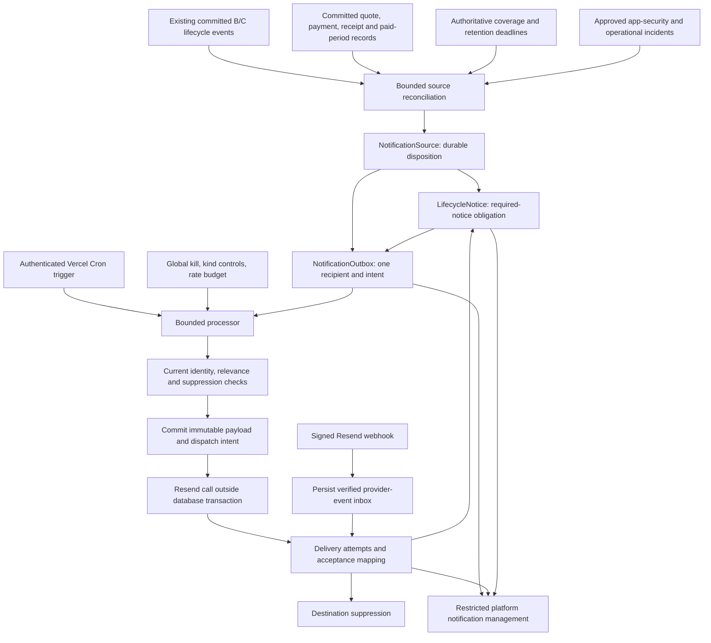

# Notification service — Checkpoint N-A architecture review

10 November follow-up: [N-B isolated implementation and acceptance](notifications-checkpoint-nb.md) records the implemented schema refinements, capture-only tests and remaining gates. The N-A proposal below is retained as historical design evidence.

9 November 2026. **Design only; awaiting approval.** No application/schema/migration, credential, DNS, provider, Cron, export-TTL or lifecycle-enforcement change is authorized by this document. No emails were sent. Checkpoint D remains outside scope.

Deliverables: this architecture/recipient/operations design and the [Prisma and index proposal](notifications-schema-proposal.md). Preserve the [B acceptance](data-lifecycle-checkpoint-b.md), [C acceptance](data-lifecycle-checkpoint-c.md) and [C notification contract](data-access-notification-contract.md).

## 1. Repository findings and release boundary

| Finding | Evidence and status |
| --- | --- |
| Durable lifecycle, export and recovery events already exist, with IDs, operation keys, policy, effective/recorded times and tenant-scoped references | **Verified in source:** [event schema](../prisma/schema.prisma#L649), [B transitions](../src/server/lifecycle/service.ts), [C event helper](../src/server/data-access/events.ts). Keep these contracts; do not rewrite their history. |
| Commercial approval and human receipt verification commit audit entries with their business records | **Verified:** [quote review](../src/server/commercial/service.ts#L72), [receipt verification](../src/server/commercial/service.ts#L120). `PlatformAuditEvent` is existing evidence, not an email queue. |
| Paystack creates a receipt only after authenticated transaction verification; checkout initiation is distinct | **Verified:** [checkout audit](../src/server/payments/paystack.ts#L40), [verified receipt and audit](../src/server/payments/paystack.ts#L79). Do not notify verified payment from a return URL or raw `charge.success`. |
| Paid-period creation and `SUBSCRIPTION_ACTIVATED` audit commit together; periods can start in the future for early renewals/upgrades | **Verified:** [activation](../src/server/commercial/service.ts#L150), [period schema](../prisma/schema.prisma#L593). Confirmation must not imply future entitlements already apply. |
| Platform roles, central host, live identity and strict MFA checks exist | **Verified:** [platform authorization](../src/server/commercial/platform-auth.ts#L9). Notification operations must reuse and narrowly extend this registry. |
| `LifecycleNotice` was proposed but is not implemented | **Verified:** [current schema](../prisma/schema.prisma). Propose one canonical required-notice obligation model, not a competing delivered flag on lifecycle state. |
| Membership changes/removal have transactional audits; removed-member audits do not preserve a recipient subject reference | **Verified:** [membership mutations](../src/server/services/memberships.service.ts#L20). A future additive `AuditLog.subjectUserId` is needed for affected-member notices after removal; never infer identity from deleted membership IDs. |
| Verified profile-email changes audit once per workspace, with no canonical global change ID | **Verified:** [provisioning](../src/server/auth/get-current-user.ts#L28). Do not pretend these are already a deduplicated global account-security event. Clerk/app responsibility must be settled before adding a global application email-change trigger. |
| C currently has a request/artifact lifetime of 15 minutes, including deterministic token validity | **Verified:** [export service](../src/server/data-access/exports.ts#L40), [encryption/token binding](../src/server/data-access/security.ts). The new 24-hour requirement is a separate reviewed implementation, not a configuration change made here. |
| Invitation links are generated once and only their hashes are stored | **Verified:** [invitation creation](../src/server/services/memberships.service.ts#L50). Automated invitation email remains an earlier launch requirement; its secure producer/payload design needs explicit inclusion, not reconstruction of a token from its hash. |
| No notification outbox, provider integration, legal-notice evidence or sender setup is implemented | **Verified in repository.** Actual Resend account/domain/limits, DNS, mailboxes, Vercel plan, Neon limits and provider retention **require external confirmation**. No connected account was queried or configured. |

First release: transactional commercial communications; renewal/expiry/lifecycle notices; retention/pre-deletion obligations; export/recovery; approved application-owned security events; internal alerts and delivery management. Defer marketing, abandoned signup/checkout campaigns, routine project/task messages, engagement scoring, SMS/WhatsApp/push and automatic recurring payment collection. Clerk retains its existing sign-in, verification and password responsibilities. Do not duplicate them.

## 2. Architecture and responsibilities

Use PostgreSQL as the durable queue initially. No Redis, broker or separate worker host is justified without measurements. Templates and recipient policies are immutable versioned code registries; no arbitrary email composer or live HTML editor is introduced. A provider adapter accepts only an approved frozen envelope, never arbitrary caller-supplied recipients, links or message bodies.

Responsibilities:

- **Source adapter:** interprets committed facts, never approves payments, activates tenants, changes membership, extends retention or deletes data.
- **Recipient resolver:** maps an approved policy to logical users; verifies current Clerk identity/binding and destination before dispatch. It does not require recipients to maintain an online MFA session merely to receive a generic notice; sensitive actions after the link still require existing session/MFA checks.
- **Renderer:** pins template/policy versions and safe configured central URLs; text and accessible HTML with no confidential records.
- **Processor:** claims bounded work, applies controls/leases, freezes payload, sends immediately through Resend, records attempts and uncertainty.
- **Webhook inbox/reconciler:** authenticates evidence, correlates to a frozen recipient/message, preserves facts and derives outcomes.
- **Notice evaluator:** evaluates required notice coverage under a separately approved evidence policy. Delivery is evidence, not automatic permission to purge.

Prefer immediate provider sends only. Do not schedule messages inside Resend: the application must retain the opportunity to suppress a reminder after a renewal or grant revocation.

## 3. Event → template → recipient matrix

All template names below are proposed immutable `v1` identifiers, not approved/published copy. One provider message has exactly one `To`; no cross-tenant To/CC/BCC fanout. All commercial/lifecycle recipients are **current ACTIVE OWNER memberships with a live verified Clerk binding**. Missing eligible owners create review/alert work, not guessed recipients. Never claim amounts, bank/M-Pesa details, refunds, new permissions or access tokens in email.

| Source / fact | Proposed template kind | Recipient policy / relevance |
| --- | --- | --- |
| `SubscriptionRequest.approvedAt` + committed `REQUEST_COMMERCIALLY_APPROVED` audit | `QUOTE_READY` | Current verified owners; quote still valid/unaccepted. Secure `/dashboard` link; no quotation/payment instructions in email. |
| `quoteAcceptedAt` + `SUBSCRIPTION_QUOTE_ACCEPTED` | `QUOTE_ACCEPTED` | Current verified owners; accepted version only. No payment or activation implication. |
| `SubscriptionPayment` + `PAYMENT_DETAILS_SUBMITTED` | `PAYMENT_CLAIM_RECEIVED` | Current verified owners; explicitly details received for review, not funds verified. This is a transactional acknowledgement, not checkout abandonment. |
| Same submitted claim | `PAYMENT_REVIEW_REQUIRED` | Active BILLING_ADMIN/SUPER_ADMIN users only; internal generic queue link, coalesced by incident/request policy. |
| Manual `SubscriptionPaymentReceipt` + `PAYMENT_RECEIPT_VERIFIED` | `PAYMENT_VERIFIED` | Current verified owners; receipt not reversed. Partial receipt is not full funding or activation. |
| Paystack receipt + `PAYSTACK_RECEIPT_CONFIRMED` / optional `PAYSTACK_RECONCILED` | `PAYMENT_VERIFIED` | Same canonical receipt-based intent as manual verification; never two notices for receipt plus reconciliation audit. |
| `PAYMENT_SUBMISSION_REJECTED` + rejected submission | `PAYMENT_REVIEW_UPDATED` | Current verified owners; generic authenticated status link, no internal notes. |
| `SubscriptionPaymentReversal` + `PAYMENT_RECEIPT_REVERSED` | `PAYMENT_STATUS_CHANGED` | Current verified owners; urgent authorized billing/super-admin incident. A ledger reversal is **not proof of a bank refund**. |
| `REQUEST_CLOSED` + terminal request | `COMMERCIAL_REQUEST_CLOSED` | Current verified owners; closed/rejected semantics from the record, not invented refund policy. |
| `SubscriptionPeriod` + `SUBSCRIPTION_ACTIVATED` | `SUBSCRIPTION_CONFIRMED` | Current verified owners; active-now or future-period variant. Early renewal/upgrade confirms future coverage without applying future entitlements. |
| `WORKSPACE_RESTORED` | `SUBSCRIPTION_CONFIRMED` restored variant | Reviewed claimant/current owners as independently eligible. Coalesce customer confirmation with the same new paid-period activation intent; no double activation/restoration email to the same user. |
| `WORKSPACE_REACTIVATED` | `SUBSCRIPTION_CONFIRMED` archive-renewal variant | Same paid-period intent/coalescing; do not imply post-cancellation recovery. |
| E − 7 days | `RENEWAL_APPROACHING` | Current verified owners; outstanding activated coverage actually ends at E. |
| E | `EXPIRED_GRACE_STARTED` | Current verified owners; real grace state still applies. |
| E + 5 days | `GRACE_ENDING` | Current verified owners; still in grace. |
| `WORKSPACE_ARCHIVED`, scheduled at E + 7 | `WORKSPACE_ARCHIVED` | Current verified owners; committed archive event and current state. Event and deadline share one canonical intent. |
| E + 46 days | `CANCELLATION_WARNING` | Current verified owners; cancellation still prospective under the approved policy. Required lead-time evidence needs legal approval. |
| `WORKSPACE_CANCELED`, scheduled at E + 60 | `WORKSPACE_CANCELED` | Current verified owners, using central recovery link; committed cancellation and effective deadline. |
| E + 120 days | `RETENTION_END_APPROACHING_30` | Current verified owners or separately reviewed authorized recovery recipient; retention authority still supports the deadline. |
| E + 143 days | `RETENTION_END_APPROACHING_7` | Same; no promise that deletion will occur at E + 150. |
| Required pre-deletion obligation | `PRE_DELETION_NOTICE` | Approved recipient/evidence policy and eligibility/hold adapter required. Blocked until those decisions/capabilities exist. A reminder alone is not legal sufficiency. |
| `EXPORT_REQUESTED` | `EXPORT_REQUEST_ACCEPTED` | Verified request-specific requester, not all workspace owners; scoped authority still appropriate. |
| `EXPORT_READY` | `EXPORT_AVAILABLE` | Requester currently allowed to obtain the artifact, within its lifetime; requires the separately reviewed availability policy. `/account/data`, never a token or ZIP attachment. |
| `EXPORT_FAILED` | `EXPORT_PREPARATION_FAILED` | Verified requester; sanitized retry/support guidance only. |
| `EXPORT_EXPIRED` | `EXPORT_UNAVAILABLE` | Optional informational transaction, verified requester; suppress if a newer request superseded it. No stale ready message. |
| `EXPORT_DOWNLOAD_AUTHORIZED` | None | Audit-only. Never treat as proof of browser receipt. |
| `RECOVERY_REQUESTED` | `RECOVERY_REQUEST_ACCEPTED` | Verified claimant, even without current workspace membership; generic case status only. |
| Same event | `RECOVERY_REVIEW_REQUIRED` | Active SUPER_ADMIN only; Support/Billing do not gain recovery-review authority. |
| `RECOVERY_APPROVED` | `RECOVERY_REVIEW_UPDATED` | Verified claimant; approved variant only if grant/binding/scopes remain valid. No membership transfer or activation claim. |
| `RECOVERY_REJECTED` | `RECOVERY_REVIEW_UPDATED` | Verified claimant; rejection is relevant despite no grant. No ownership evidence or internal reason disclosed. |
| `RECOVERY_REVOKED` | `RECOVERY_ACCESS_WITHDRAWN` | Verified claimant; deliberately does not require the revoked grant to be usable. |
| `RECOVERY_GRANT_EXPIRED` | `RECOVERY_ACCESS_EXPIRED` | Verified claimant; no live grant required to receive a generic expiration notice. |
| Existing `MEMBERSHIP_CHANGED` / `MEMBERSHIP_REMOVED` audit | `WORKSPACE_ACCESS_CHANGED` | Current verified owners; affected verified user only after an additive subject-user reference is captured before removal. No membership history in content. |
| Verified app-owned global account change, if responsibility approved | `ACCOUNT_SECURITY_UPDATED` | Current verified account identity only. A canonical operation source must be added transactionally; current per-workspace email-change audits are insufficient. Do not duplicate Clerk emails. |
| Backlog, provider-configuration failure, missed required notice, uncertain critical send | `NOTIFICATION_OPERATIONS_ALERT` | Active SUPER_ADMIN/on-call authorized users; billing subset only for billing incidents. One coalesced incident; UI/monitoring must remain available if email itself fails. |
| Actual future deletion/anonymization completion event | Future `DATA_REMOVAL_COMPLETED` | **Unavailable today.** Requires separately approved D completion evidence; a calculated date can never generate it. |
| Checkout initialization / success redirect / unverified provider callback | None | No payment-confirmed or subscription-active message. |
| Clerk sign-in/password/email-verification flow | Clerk-owned | No application duplicate by default. Confirm other account-security responsibilities before adding them. |

Every enabled kind must have an explicit audience policy; unsupported kinds deny by default. Invitation email is a previously requested launch item but not explicitly enumerated in this N-A release list. Decide its inclusion separately; the current hash-only invitation token cannot be safely reconstructed during reconciliation. No automated invitation flow is silently added here.

## 4. Scheduling, suppression and legal evidence

### Authoritative time

Use server-controlled UTC and the existing calendar-day policy. Build coverage from activated, non-revoked periods. A contiguous activated future renewal starting at the old end suppresses the old expiry reminders without changing current entitlements. Do not use browser time, mutable `Subscription.currentPeriodEnd` alone, submitted payments or an unactivated funded request. Do not bridge arbitrary gaps by taking the maximum of every future period.

Each scheduled source key identifies workspace, paid-coverage episode, milestone and policy. Renewals create the next coverage episode; preserve old notification/evidence history and cancel unsent stale work. Post-cancellation deadlines use the persisted effective cancellation/retention authority, not scheduler observation time. A changed hold/obligation must come through a reviewed retention authority; notification code cannot invent one.

| Kind | UTC due time | Proposed lateness handling for review |
| --- | --- | --- |
| Renewal approaching | E − 7 days | Target within 24 hours; otherwise skip historical reminder and review current-status communication |
| Grace started | E | Within 24 hours and still in grace |
| Grace ending | E + 5 days | Within 24 hours and strictly before grace ends |
| Archived | E + 7 days | Committed event, within 24 hours of effective archive, still archived |
| Cancellation warning | E + 46 days | Required minimum lead time must be approved; missed/late legal warning becomes REVIEW_REQUIRED |
| Canceled | E + 60 days | Committed event; late confirmation needs current, accurate wording and review if required notice was missed |
| Retention 30-day warning | E + 120 days | Current approved deadline; missed legal milestone requires review |
| Retention 7-day warning | E + 143 days | Same; never infer that purge is authorized |

These delivery windows/lead-time evidence rules are **proposals**, not legal determinations. Use actual dates/as-of wording rather than claiming “seven days remaining” after a delay. Do not replay every missed milestone after an outage. Record missed obligations and propose one current-state communication for review. Required pre-deletion notices with insufficient lead time continue to block destruction.

### Event/deadline coalescing

For archive and cancellation, both event ingestion and scheduling address the same canonical source key: `workspace/<id>/episode/<period-id>/<milestone>`. The scheduler can create a pending obligation, but cannot claim a confirmed transition before the committed domain event exists. A missing event raises an operational gap; the mail processor does not execute cancellation itself.

Normalize manual/Paystack verification to one receipt intent. Normalize restoration/renewal/period activation to one customer confirmation per new paid period and eligible user. Template version changes do not create another logical notification. Retain per-event processing dispositions so intentionally audit-only or no-recipient events do not disappear or generate an endless ingestion loop.

### Suppressions and changes

Before every dispatch, resolve relevance and recipient again: current owner role/status, verified Clerk external binding/current primary destination, request-specific authority, grant expiry/revocation, artifact consumption/expiry, paid-period revocation, commercial status and applicable retention restrictions. Notification links never confer access.

`RECOVERY_REVOKED`, `RECOVERY_REJECTED`, `RECOVERY_GRANT_EXPIRED` and generic security notices use a **status-notice** policy: no valid access grant is needed to tell the verified claimant that access is unavailable. `EXPORT_READY` and an approved-grant variant require the stricter current access policy. Applying the ready policy to all recovery messages would incorrectly suppress the very revocation notice intended for the user.

Before first dispatch, an identity change can invalidate a pending destination and require fresh resolution. After a payload has been frozen/dispatched, never change its destination/body and reuse the provider key. Stop retries to a now-unverified destination, reconcile any uncertain original send, and require a reviewed replacement when safe. Never relink legacy accounts by matching an email.

Hard bounces, complaints and provider suppressions suppress the normalized destination across relevant sends, without exposing another tenant's suppression details. Essential status is not permission to bypass suppression. An undeliverable required notice becomes a visible unresolved obligation requiring an approved alternative/review.

### One legal-notice evidence source

Introduce `LifecycleNotice` only as the **required-notice obligation**: workspace/episode, milestone, due/deadline, recipient/evidence policy version and review status. Link each recipient-specific outbox intent to it. Delivery facts stay in attempts/provider events. No second `emailDelivered` boolean on lifecycle rows, no duplicated legal proof table.

Coverage must account for the approved owner/claimant audience and minimum lead time. No verified owner, unknown hold/deadline, bounce, provider-accepted-only result, uncertain delivery or missed legal deadline means REVIEW_REQUIRED. Only an explicit approved evidence policy may resolve an obligation; preserve resolution actor/reason/evidence references. “Satisfied notice obligation” never means “purge approved.” D's independent holds/export/backup checks remain necessary.

## 5. Outbox/processor contract and uncertainty

### Creation and discovery

1. Reconcile committed lifecycle events using anti-joins against durable `NotificationSource` dispositions, not a recorded-time watermark. Add a missing-event index; process bounded pages and repeat gap scans, including late commits with old recorded times.
2. Reconcile canonical commercial records/audits with unique source keys; future producers may insert normalized source rows within the same business transaction. Do not send while the business transaction is open.
3. Record a source even when it is AUDIT_ONLY, awaiting recipients or awaiting a transition. Recipient absence gets a retry/review reason. Create source, notice obligation and intended outbox messages transactionally with database uniqueness.
4. Cutover requires an approved historical-reconciliation policy. Mark older sources as historical review/suppression; do not mass-email old events or silently treat missed old legal notices as satisfied.

RESOLVED means initial fanout was reconciled, not that an audience is permanently frozen. Within a valid send window, periodically revisit sources via `nextReconcileAt` and relevant membership-change signals: cancel a former owner's unsent intent and add a newly eligible owner's unique intent. Request-specific C audiences remain fixed to their claimant. Outside the allowed window, a changed legally required audience needs explicit obligation review, not a backdated resend. Preserve all earlier factual delivery evidence.

### Claim, freeze, send, settle

1. Authenticate the exact central machine endpoint with a strong server-only bearer secret. Apply global environment kill, database controls, kind allowlist, environment/provider binding and a test-recipient allowlist. Defaults: capture/dry-run only; external sending disabled.
2. In a short transaction, acquire a bounded worker lease and claim due outbox rows with `FOR UPDATE SKIP LOCKED`; set random lease token/version and expiry. Reserve a lane for urgent legal/security incidents while preserving standard-lane progress. A lease is coordination, not recipient authorization.
3. Resolve live recipient/source validity outside long transactions. Briefly recheck database relevance/authority under existing lock order. Freeze approved template bytes, exact To/From/Reply-To, text/HTML, safe links and provider tags in encrypted storage; persist hash, identity/destination digest, provider account/environment, stable provider key and first-dispatch intent **before** making a network call.
4. Allocate a rate permit transactionally; if not due, schedule `nextAttemptAt` and release work without burning an actual send attempt. Never sleep through backoff inside a Vercel invocation.
5. **Commit, then call Resend. No database transaction stays open during provider I/O.** Use an SDK with explicit timeout/retry configuration; hidden SDK retries must preserve the same key/payload and fit the recorded attempt policy.
6. Persist the outcome in a new transaction, conditioned on the lease token/version. Late workers cannot overwrite newer claims. Store factual provider evidence even if business relevance changed while the send was on the wire; do not pretend an accepted message can be recalled.

Proposed initial bounds: 20 intended sends/run, two in-flight provider calls, five-second call timeout, 20-second admission budget, 30-second route budget and 90-second leases; shared starting ceiling one API request/second. Allocate up to 15 urgent/5 standard slots, borrowing unused capacity. These are estimates for isolated tests and must be tuned to actual provider/team/function limits. Per-message leases and idempotency remain correctness controls even if a global worker lease limits routine overlap.

The throughput estimate assumes one invocation per minute on a plan that permits that frequency; the actual Vercel plan is unverified. Very short recovery grants may leave no useful email window: cap a ready notice by both artifact and grant deadlines, suppress it when it cannot remain accurate, and keep the authenticated UI authoritative. Never extend a grant to accommodate mail latency.

### State separation

`processingState`: PENDING, CLAIMED, RETRY_PENDING, SETTLED, CANCELED, SUPPRESSED, MANUAL_REVIEW. `deliveryOutcome`: NOT_SENT, UNKNOWN, PROVIDER_ACCEPTED, DELIVERED_TO_SERVER, DELAYED, BOUNCED, COMPLAINED, FAILED.

The admin UI can derive a friendly progression, but processing and delivery are independent. HTTP success/provider message ID means acceptance, not recipient delivery. Resend's delivered event means delivery to the recipient's mail server, not proof of reading or browser interaction. [Resend delivery semantics](https://resend.com/docs/webhooks/emails/delivered).

Retain distinct accepted/delivered/bounced/complained evidence timestamps; an out-of-order `email.sent` must not erase delivery or a complaint. Contradictory evidence requires review. A later source cancellation does not erase the factual outcome of an already-sent message.

### Retry and exactly-once limits

Database uniqueness prevents duplicate logical intents. It cannot make an external side effect permanently exactly-once. Resend retains idempotency keys for **24 hours**; use one stable key and the identical frozen payload for retries within a conservative local safe window (proposed 23 hours from first dispatch). [Resend idempotency documentation](https://resend.com/docs/dashboard/emails/idempotency-keys).

- Proposed bounded backoff: 1, 5, 15, 60, 180 and 360 minutes with jitter; at most eight dispatched attempts, constrained by relevance/deadline/safe window. Respect provider `retry-after` and shared reset headers; do not assume limits are per API key. [Resend usage limits](https://resend.com/docs/api-reference/rate-limit).
- Confirmed validation/configuration errors are permanent or pause-the-channel failures, not blind retries. Rate limiting defers admission. Timeouts/ambiguous 5xx after dispatch are UNKNOWN, not proven unsent.
- A crash before/after HTTP acceptance is reconciled with the same provider key while safe. If uncertainty survives the window, set MANUAL_REVIEW/UNKNOWN; retrieve provider evidence where possible. **Never blindly resend after 24 hours**, even with the old key.
- A reviewed replacement is a distinct generation with a new provider key and audit linkage. Permit it only after reliable evidence the original was not accepted, or a separately approved new communication purpose. Absence from one API page is not proof of no send. No “force retry unknown” button in the initial release.
- Source/identity/kill-switch changes can occur after the last check and after a request is on the wire. State checks narrow that race; they cannot revoke a received email. Generic content and authenticated links prevent an email becoming an access capability.

## 6. Resend, sender and webhook plan

Proposed, **not verified or configured**:

| Purpose | Sender proposal | Reply-To proposal |
| --- | --- | --- |
| Transactional customer notices | `WorkflowConnect <notifications@notify.workflowconnect.io>` | Monitored `info@stravectsystems.com`, subject to operator confirmation |
| Internal operational alerts | `WorkflowConnect Operations <alerts@ops-mail.workflowconnect.io>` | Approved monitored operations mailbox; address pending |
| Marketing | Separate future domain/identity only after approval | Out of release scope |

Verify WorkflowConnect's own sending domains/account explicitly. Do not assume another Stravect product's verified domain or limit applies. Use provider-issued DNS values for SPF/DKIM and approved DMARC alignment/reporting; do not copy generic example records over existing SPF. Confirm reply handling, domain ownership, DNS authority and mailbox monitoring. Separate sending purposes/subdomains help isolate settings/reputation. [Resend verified-domain guidance](https://resend.com/docs/dashboard/domains/introduction).

Keep API keys server-only, scoped to approved domain/purpose where supported, in the correct environment/account. Use separate isolated testing credentials/allowlists and live delivery approval. No public-prefixed keys. Proposed future configuration: `RESEND_API_KEY`, `RESEND_WEBHOOK_SECRET`, explicit provider/account reference, sender/reply-to settings, `COREOPS_NOTIFICATIONS_CAPTURE_ENABLED`, `COREOPS_NOTIFICATIONS_SEND_ENABLED` (default false), kind controls, rate/batch limits and a dedicated processor secret. These are **not implemented settings** in N-A.

Template approval includes plain text and accessible HTML: semantic headings, readable type/contrast, meaningful link labels and image alternatives if images are used. No image-only alerts, tracking pixels, misleading buttons or promotional content in essential notices.

Webhook proposal: exact central POST `/api/notifications/resend/webhook`, signature-authenticated and independent of interactive Clerk. Reject inappropriate hosts/methods. Bound raw body size (proposed 128 KiB), verify the untouched bytes plus `svix-id`, `svix-timestamp`, `svix-signature` with the supported Resend/Svix verifier and timestamp tolerance **before** processing. Never parse and reserialize to verify a signature. [Official verification requirements](https://resend.com/docs/webhooks/verify-webhooks-requests).

Persist a verified, deduplicated inbox row before acknowledging. If persistence fails, return retryable failure; do not ACK then launch an unawaited in-process promise. Duplicate ID plus matching body digest is idempotent; the same ID with a different digest is a security conflict. Subscribe only to required delivery/failure/suppression events; disable open and click tracking by default. Legitimate manual replay may contain an old occurrence time with a fresh authenticated delivery envelope. [Resend webhook replay guidance](https://resend.com/docs/webhooks/retries-and-replays).

Correlate provider account/environment + email ID + exactly one frozen recipient. Provider tags contain opaque notification ID only; tags alone are not authority. Unknown/unmatched events remain quarantined for bounded reconciliation, never update a guessed user's delivery. A webhook can precede the HTTP response: recover correlation using the verified tag/destination and authenticated provider retrieval; enforce unique provider-message mapping. Do not require current tenant membership merely to retain a historical delivery fact.

Use Resend's opaque `data.email_id` for message identity, not an arbitrary RFC Message-ID string. Verify dedicated account/available filtering before integration; a shared account must not cause storage of another product's subjects or bodies. Authenticated malformed/out-of-scope events may retain a minimal quarantined receipt without being treated as delivery. Unknown recipient/message fields must stay unknown rather than being fabricated to satisfy the inbox schema.

Store normalized event evidence and digest. If encrypted raw evidence is needed for dispute verification, its size, access and short retention require approval; never log entire provider bodies or retain them indefinitely. Bounce/complaint evidence maps to the **sent destination**, not an account's later replacement email. Suppression removal requires provider evidence and audited approval; changing to a genuinely new verified email does not automatically clear suppression on the old one.

Outage behavior: stop/slow sends on configuration failures/quota exhaustion, preserve intents, continue valid webhook evidence capture, display backlog/unknown outcomes. A notification about the notification provider failing must not recurse through the same failing channel. Use dashboard plus separately approved platform monitoring/on-call procedures.

## 7. Separate export-availability review

The approved product target is **at most 24 hours after successful generation**, not “24 hours after request.” No TTL code changes occur in N-A. C's current 15-minute behavior remains true.

Proposed reviewed N-X change:

1. Split generation/request deadline from `generatedAt`/`artifactExpiresAt`; keep bounded generation. Set artifact expiry no later than generation +24 hours, with earlier cleanup on consumption, revocation or loss of required recovery authority.
2. Issue independent short-lived (proposed five-minute), single-use download authorization only after fresh identity/MFA and current authority. Bound it by artifact expiry and any grant deadline; rotate/hash authorization so a refreshed token invalidates its predecessor. A 24-hour file is never a 24-hour bearer capability.
3. Keep recovery grants at their approved 1–60-minute lifetimes. Do not extend them to match files. An expired/revoked grant cannot issue or consume a token; define early cleanup of its otherwise-retained ciphertext.
4. Reassess C's one-open-export-per-workspace index: keeping a ready file for a day can block another owner. Propose own-request cancellation/supersession with MFA and audited exceptional supersession; decide policy before relaxing the index or increasing storage.
5. Preserve encrypted database storage only if measured storage/WAL/backup/connection cost and cleanup latency fit. Keep all current row/source/ZIP caps, concurrency and purge leases until a separate review approves adjustments.
6. Update UI, privacy/retention disclosures, tests and notification validity checks together. Keep `EXPORT_READY` outbound email disabled until an approved availability/latency contract is implemented, rather than promising 24 hours against C's 15-minute code.

Steady-state retained bytes are approximately completed exports/day × mean retained bytes × mean unconsumed retention in days. With equal arrival rate and no early consumption, 24 hours is **96×** the retention of 15 minutes. Example estimate: 100 exports/day ×2 MiB ≈200 MiB at 24 hours versus ≈2.1 MiB at 15 minutes. One 8 MiB ready artifact for each of 1,000 workspaces is ≈7.8 GiB before WAL, indexes, backups and replicas. These are scenarios, not observed workload. Clearing ByteA does not erase historical backups.

No external object store/worker will be configured without a measured proposal and approval. The safe outcomes beyond capacity are a visible failure/review or approved private infrastructure, never public archives or silently incomplete exports.

## 8. Administration, privacy and evidence retention

Propose `/platform/notifications` on the central host, using existing active database role/MFA checks. No public administrator registration and no automatic tenant-data access.

| Role | Proposed authority |
| --- | --- |
| SUPPORT | Redacted operational counts/status; no recipient addresses, frozen payloads, evidence documents or send/retry override |
| BILLING_ADMIN | Billing-category metadata and narrowly safe retry/suppression proposals; no export/recovery content or legal-waiver authority |
| SUPER_ADMIN | Approved kind/configuration controls, reviewed safe retries, uncertainty/required-notice review, audited suppression administration; no arbitrary recipients/body or bypass of identity/legal checks |

Every mutation needs a bounded reason, current transactional administrator recheck and `PlatformAuditEvent`. Retry keeps the frozen payload/key; an accepted/delivered or unknown-outside-window item is not a normal retry candidate. Required-notice resolution needs explicit legal/evidence authority, not merely the ability to click a platform button.

UX: overview counts by processing/outcome; oldest actionable backlog and last completed run; pending/retry/dead-letter queues; provider-accepted versus delivered-to-server badges; bounce/suppression views; legal-obligation review; per-kind/template health; incident history. Detail pages show a sanitized timeline and recipient masking by role. Do not render arbitrary stored HTML; approved template preview uses synthetic content. Audit-only events and canceled notices remain visible as dispositions without inflating sent counts.

Retention proposals requiring review: frozen encrypted payload only through safe retry/reconciliation and an approved short support window; normalized attempts/provider evidence under a purpose-specific operational schedule; legal-notice evidence under its approved obligation/dispute schedule. No indefinite raw-event/body archive by default. Suppression fingerprints need a reviewed anti-abuse purpose and release policy. Logs contain IDs, durations, counts and sanitized codes, never full emails, message bodies, credentials or ZIPs.

Resend is an additional proposed processor of verified email destinations and generic content. Account region, subprocessors, international transfers, DPA, provider data controls and deletion/backups require external/legal confirmation. Do not infer them from the repository or a pricing page. Essential service notices are not marketing consent; a `NotificationPreference` table is deferred until actual optional preference requirements exist.

## 9. Capacity assumptions and test plan

### Estimates, not sizing guarantees

Example 1,000 workspaces ×1.2 eligible owners ×5 monthly commercial/reminder notices ≈6,000 customer emails/month (~200/day), before churn/legal/recovery/export/internal traffic. Actual notice counts depend on renewals and suppressions. A 1,200-recipient aligned deadline takes at least ~60 minutes at an estimated 20 sends/minute; mixed priority reservations and provider latency can make it longer. Do not claim instantaneous Cron processing.

Public pricing reviewed today lists Free at 3,000 emails/month and 100/day; Pro at US$20/month for 50,000, with US$0.90/1,000 overage. The illustrative workload exceeds Free's daily cap; it is not authorization to buy a plan or enable overages. Taxes, account agreement and actual usage are unverified. [Resend pricing](https://resend.com/pricing).

Published team API ceiling is currently 10 requests/second shared across its API keys; configure against the actual account and other products' traffic, not that ceiling alone. [Provider limits](https://resend.com/docs/api-reference/rate-limit). Vercel Cron delivery/concurrency and function limits require explicit application safeguards, not exactly-once assumptions. [Vercel Cron management](https://vercel.com/docs/schedules/cron-jobs/manage-cron-jobs).

If 10,000 logical messages/month have three stored attempt/event rows each, that is ~30,000 dependent rows/month plus source/outbox/run/notice records. At an assumed ~2 KiB normalized evidence row this is ~60 MiB raw dependent data/month, excluding indexes, encrypted payloads and backups. A maximum 32 KiB frozen generic payload ×10,000 retained messages adds up to ~313 MiB before early cleanup. Measure actual row/index sizes; do not use these estimates as Neon plan approval.

Use pooled application connections and direct migration connections under the existing deployment contract. Measure peak pool occupancy from business requests + processor + webhook + artifact operations, queue lag, query plans, WAL, vacuum/bloat, retention cleanup, provider quotas and cost. Bound lease claim queries with partial indexes; avoid large transactions and per-message blind polling. Bootstrap at low synthetic throughput and prove target service levels before increasing.

### Isolated acceptance plan

| Scenario | Required proof |
| --- | --- |
| Duplicate events, late commit behind scan watermark, audit-only/no-recipient events | One durable source disposition; one logical message per audience; gap scan eventually finds every eligible commit |
| Concurrent workers / crash before claim, dispatch, acceptance persistence | Lease/CAS correctness, no lost messages, stable payload/key retries and visible UNKNOWN state |
| Provider timeout / idempotency-window exhaustion | Same-key safe retries only within window; no automatic resend outside it; operator evidence required |
| 429/quota/configuration/outage | Shared rate permits/backoff, no in-function sleep storm, channel pause and independent dashboard incident |
| Raw-body tampering, bad signature, replay and ID/digest conflict | No false delivery; durable verified inbox before ACK; dedup and quarantine |
| Callback before HTTP mapping / out-of-order accepted-delivered-bounce-complaint | Correct account/message/recipient mapping; preserved evidence, no status regression or suppression on a new email |
| Owner/role/email changes, legacy collisions, revoked/suspended identities | No email-derived rebinding, stale destination retry or cross-tenant disclosure |
| Recovery rejected/revoked/expired versus export ready | Status notices can reach verified claimant; ready/access messages suppressed when authority ends |
| Renewal/reversal immediately before reminder and concurrent send | Relevance checked against activated coverage; no premature future-entitlement claim; unavoidable on-wire race documented |
| Missing transition, unknown hold/retention authority, missed required notice | Review-required obligation; no manufactured cancellation/deletion confirmation and no purge permission |
| Connection exhaustion and 10× target burst/backlog | Bounded resources, measured p95/p99 latency, no starvation, resumed progress after recovery |
| 24-hour artifact policy (separate N-X) | Generation-based expiry, independent short tokens, grant revocation, storage/backups/cleanup and supersession tests |

Use isolated PostgreSQL and fake provider first. Any real provider acceptance requires explicit approval, provider test facilities where supported and hardcoded/approved disposable inbox allowlists; no customer addresses. Verify delivered/bounced/complained examples and actual inbox accessibility before claiming external delivery. Preserve existing authorization, lifecycle, commercial, identity, payment, navigation and C export regressions, plus typecheck/lint/build and migration rehearsal.

## 10. Incremental approvals and outstanding decisions

| Checkpoint proposal | Scope / approval boundary |
| --- | --- |
| **N-A — this review** | Design documents only; no implementation authorization inferred |
| N-B | Approved additive schema, typed source adapters, reconciliation, required-notice obligations, fake sink/dry-run processor and isolated migrations/tests; external delivery still off |
| N-C | Frozen payloads, leases/rate controls, simulated provider/webhook/unknown-result handling, restricted admin UI and security tests; no live email |
| N-D | Separately approved WorkflowConnect domain/account/DNS/credentials and disposable-inbox provider acceptance; no customer sending |
| N-X | Separate reviewed 24-hour artifact/token/storage change, independent of notification implementation and still isolated |
| N-E | Reviewed operational recipient/template/legal policy, provider acceptance, target capacity and explicit delivery rollout approval. This does **not** enable lifecycle enforcement or approve data deletion. |

Decisions needed before implementation/rollout:

1. Approve current-owner/all-owner audiences, C claimant/status distinctions, internal role routing, commercial coalescing and the Clerk/app security responsibility boundary. Decide invitation-email inclusion explicitly.
2. Approve actual template copy/versions, lateness windows, legal lead times, notice evidence thresholds, alternative handling and who may resolve obligations. Legal hold/retention authority and deletion completion sources do not exist yet.
3. Confirm dedicated WorkflowConnect Resend account/domain, sender/reply-to monitoring, DNS ownership, limits, budget, processor isolation and provider legal/data-processing arrangements.
4. Review the additive schema/index proposal, source-history cutover, encrypted payload/evidence/suppression retention and notification audit visibility.
5. Approve retry/unknown-outcome/replacement policy and operational response when no reliable provider evidence exists. No platform control may silently transform UNKNOWN into delivered or unsent.
6. Review N-X generation-based 24-hour storage and short authorization policy, one-open-export consequences, grant lifetimes, backup/storage capacity and cleanup service levels.
7. Complete real Clerk/MFA/browser acceptance still outstanding from C; do not weaken that gate or introduce an email-based access bypass.

### Verification and stop

Repository/source inspection and public primary-provider documentation review only. No database connection, migration, provider configuration, email, schedule, TTL or live-enforcement action was performed. No application tests/build were run because no runtime change was made. Existing working-tree implementation changes were preserved.

**Stop for N-A architecture review.** Approval is required before N-B or N-X implementation; no notification sending, live setup, lifecycle activation or Checkpoint D work follows automatically.
