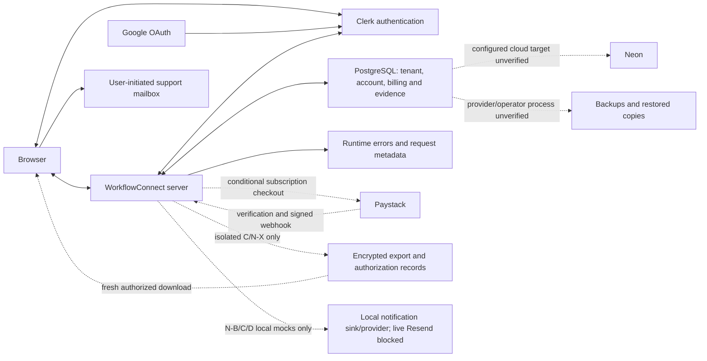

# WorkflowConnect — Privacy Compliance Readiness Report

11 November 2026. **Read-only closure review through Lifecycle B/C and Notifications N-A/B/C/D/N-X. Production readiness is not approved.** N-X acceptance as isolated engineering does not establish deployed privacy compliance.

## Scope, baseline and classification

The complete **8 November 2026 audit supplied in this review** is the baseline. This report reconciles all nine of its ranked findings, every retention-matrix item, its security controls, inventory/processor categories and eight Privacy Policy sections. Historical line numbers have been replaced with current source references. The earlier lifecycle implementation attachment also independently quotes eight baseline lifecycle findings.

Classifications:

- **Verified Implemented:** the specific control exists in current source/schema. Its operational scope is stated separately; this is not certification of a deployed environment.
- **Partially Implemented:** a related implementation exists, but the original finding's complete outcome is unmet.
- **Not Implemented:** the required application capability/evidence mechanism was not found. External manual practices are not presumed absent unless verified.
- **Requires External Confirmation:** depends on actual deployments, accounts, contracts, operators, jurisdictions or provider settings not examined here.

**Operational evidence boundary:** no control is certified here as deployed and operational. Ordinary identity/authorization/grace controls are on the standard application path, but their deployed revision/settings are unverified. Lifecycle cancellation, secure exports and notification engineering are explicitly restricted to isolated local rehearsals. No production/preview database, dashboard, authenticated browser, mailbox, customer records, `.env` values or backup contents were accessed. No tests, builds, migrations, deployment commands or scheduled jobs ran. Only this requested non-legal report was created; application code, existing documents and settings were left unchanged.

Source: [lifecycle release gate](/home/rmuya/rhoda-work/coreops_dashboard/src/server/lifecycle/config.ts:5), [export gate](/home/rmuya/rhoda-work/coreops_dashboard/src/server/data-access/security.ts:11), [notification gate](/home/rmuya/rhoda-work/coreops_dashboard/src/server/notifications/config.ts:5), [real-send barrier](/home/rmuya/rhoda-work/coreops_dashboard/src/server/notifications/resend/release.ts:4). Historical test evidence in [N-X](/home/rmuya/rhoda-work/coreops_dashboard/docs/exports-checkpoint-nx.md), [N-D](/home/rmuya/rhoda-work/coreops_dashboard/docs/notifications-checkpoint-nd.md), [C](/home/rmuya/rhoda-work/coreops_dashboard/docs/data-lifecycle-checkpoint-c.md) and [B](/home/rmuya/rhoda-work/coreops_dashboard/docs/data-lifecycle-checkpoint-b.md) was reviewed, not rerun. Their passing mocked-boundary tests do not prove real Clerk, legal acceptance, provider delivery, storage retention or production operation.

## 1. Every original ranked finding: disposition

| Original finding | Current disposition | Exact implementation evidence and remaining outcome | Operational scope |
| --- | --- | --- | --- |
| **P0 lifecycle-policy mismatch:** indefinite expired reads; archival/cancellation/retention/deletion absent | **Partially Implemented** | B calculates archive E+7, cancellation E+60 and retention end E+150 UTC, journals transitions and denies canceled reads when enabled. However, the default commercial path still permits qualifying expired paid workspaces to remain readable indefinitely. Secure deletion is absent. [policy:10](/home/rmuya/rhoda-work/coreops_dashboard/src/server/lifecycle/policy.ts:10), [access:8](/home/rmuya/rhoda-work/coreops_dashboard/src/server/commercial/access.ts:8), [gate:5](/home/rmuya/rhoda-work/coreops_dashboard/src/server/lifecycle/config.ts:5). | Seven-day grace is standard-path code. New enforcement is isolated-only and cannot be enabled on Vercel by ordinary flags; no live-policy closure. |
| **P1 raw quick-invoice errors** | **Not Implemented** — quick-invoice remediation; exposure remains | New identity/export/notification paths sanitize many errors, but quick invoice still logs the **whole exception** and returns **`error.message`** to the browser. This is not remediated by N-D/N-X. [action:78](/home/rmuya/rhoda-work/coreops_dashboard/src/features/quick-add/actions/quick-create-invoice.ts:78), [sanitized identity errors:18](/home/rmuya/rhoda-work/coreops_dashboard/src/server/auth/clerk-identity.ts:18), [download error:33](/home/rmuya/rhoda-work/coreops_dashboard/src/server/data-access/download-handler.ts:33). No live sensitive disclosure was reproduced. | Defect is in the standard action path; actual deployed revision/log contents unknown. |
| **P1 export/erasure fulfillment gap** | **Partially Implemented** | C/N-X provide scoped Owner/reviewed-claimant export and recovery with MFA, encrypted artifacts and current authority checks. They do not implement global data-subject access/erasure fulfillment or tenant purge. [export authority:15](/home/rmuya/rhoda-work/coreops_dashboard/src/server/data-access/exports.ts:15), [issuance:41](/home/rmuya/rhoda-work/coreops_dashboard/src/server/data-access/exports.ts:41), [recovery review:35](/home/rmuya/rhoda-work/coreops_dashboard/src/server/data-access/recovery.ts:35), [export schema:29](/home/rmuya/rhoda-work/coreops_dashboard/src/server/data-access/export-content.ts:29). | Export/recovery are isolated-only. No general deployed rights-fulfillment result. |
| **P1 backup deletion/restore gap** | **Partially Implemented** | Rehearsals and a local notification witness improve engineering evidence. Neither implements independent production deletion-ledger reconciliation, restored-data quarantine/admission, or proven provider destruction schedules. [production witness throws:22](/home/rmuya/rhoda-work/coreops_dashboard/src/server/notifications/resend/restore-ledger.ts:22), [D design remains proposed](/home/rmuya/rhoda-work/coreops_dashboard/docs/data-lifecycle-checkpoint-a.md). | Local fixtures only; provider backup/restore settings require external confirmation. |
| **P1 provider-side deletion/final ownership boundary** | **Partially Implemented** | Membership changes/removal preserve the last active Owner. Account UI opens Clerk profile management only if both remote and profile deletion flags prove self-deletion disabled; registration readiness checks that setting too. This does not intercept privileged Clerk deletion or implement end-to-end account erasure. [last-owner guard:23](/home/rmuya/rhoda-work/coreops_dashboard/src/server/services/memberships.service.ts:23), [remove:38](/home/rmuya/rhoda-work/coreops_dashboard/src/server/services/memberships.service.ts:38), [account:18](/home/rmuya/rhoda-work/coreops_dashboard/src/app/account/[[...account]]/page.tsx:18), [readiness:22](/home/rmuya/rhoda-work/coreops_dashboard/src/lib/auth/registration-readiness.ts:22). | Standard-path safeguards; actual Clerk instance/MFA/recovery/deletion settings unverified. Old reports of enabled deletion/disabled MFA are historical, not current dashboard evidence. |
| **P1 legal approval/exact accepted-text evidence** | **Partially Implemented** | Authenticated explicit receipts are race-safe and preserve initial version-pair/time/URLs. They contain no document body/hash, immutable publication/approval identity or receipt-linked archived content. The approval flag/dates are not legal review. [receipt:23](/home/rmuya/rhoda-work/coreops_dashboard/src/server/auth/legal-acceptance.ts:23), [schema:327](/home/rmuya/rhoda-work/coreops_dashboard/prisma/schema.prisma:327), [configuration:21](/home/rmuya/rhoda-work/coreops_dashboard/src/config/auth.ts:21), [renderer:8](/home/rmuya/rhoda-work/coreops_dashboard/src/components/auth/LegalDocument.tsx:8). | Source mechanisms exist; approved/public documents, real receipts and durable archives remain unverified. Exact accepted wording cannot be reconstructed from application evidence alone. |
| **P1 processors/transfers/IAM uncertainty** | **Requires External Confirmation** | Source establishes intended data flows, not applicable agreements, countries, actual products/accounts, log drains or privileged access. N-D is mock-only and does not establish a live Resend relationship. [Prisma:4](/home/rmuya/rhoda-work/coreops_dashboard/src/server/db/prisma.ts:4), [Paystack:49](/home/rmuya/rhoda-work/coreops_dashboard/src/server/payments/paystack.ts:49), [Resend barrier:4](/home/rmuya/rhoda-work/coreops_dashboard/src/server/notifications/resend/release.ts:4). | No external operational/contractual closure. |
| **P2 URL/log minimization** | **Partially Implemented** | Export tokens now use protected POST bodies and hash-only storage. Invitation tokens still appear in `/invitations/[token]`; search terms still enter query strings; Paystack callback references remain linkable identifiers. [download:24](/home/rmuya/rhoda-work/coreops_dashboard/src/server/data-access/download-handler.ts:24), [invitation URL:26](/home/rmuya/rhoda-work/coreops_dashboard/src/features/memberships/actions.ts:26), [search:15](/home/rmuya/rhoda-work/coreops_dashboard/src/features/clients/components/ClientFilters.tsx:15), [callback:50](/home/rmuya/rhoda-work/coreops_dashboard/src/server/payments/paystack.ts:50). | Export fix isolated-only; invitation/search standard-path behavior remains. Actual URL/log/referrer redaction unverified. |
| **P2 audit-read/operator coverage** | **Partially Implemented** | B/C/N-X add atomic transition, grant and authorized-export-attempt evidence; new platform/notification projections restrict fields by role. There is still no general business-read/operator-access audit or verified hosting/database-console access history. [mutation audit:29](/home/rmuya/rhoda-work/coreops_dashboard/src/server/authorization/authorize.ts:29), [Owner activity projection:3](/home/rmuya/rhoda-work/coreops_dashboard/src/server/services/activity.service.ts:3), [platform history:286](/home/rmuya/rhoda-work/coreops_dashboard/src/server/commercial/service.ts:286), [export issuance:53](/home/rmuya/rhoda-work/coreops_dashboard/src/server/data-access/exports.ts:53). | Ordinary mutation audits exist in standard code; new events isolated; infrastructure audit/IAM unverified. |

**None of the original findings is closed as a deployed production practice by the evidence available in this review.** Some specific engineering controls are verified below; absence of operational evidence is not a claim that every deployed setting is insecure.

## 2. Original retention matrix: approved policy versus actual behavior

Let E be the applicable activated, non-revoked paid coverage end. A submitted/funded request alone is not paid coverage. Client archival is not workspace archival.

| Original matrix item | Classification | Current evidence and practical boundary |
| --- | --- | --- |
| Seven-day grace | **Verified Implemented** | Writes remain available until the exclusive grace deadline; [access:14](/home/rmuya/rhoda-work/coreops_dashboard/src/server/commercial/access.ts:14) and paid-period checks in [commercial SQL:6](/home/rmuya/rhoda-work/coreops_dashboard/prisma/migrations/20261106000200_commercial_constraints/migration.sql:6). Standard application path, deployment unverified. |
| Workspace archive after grace | **Partially Implemented** | E+7 becomes ARCHIVED, role-filtered reads continue, ordinary writes stop. [policy:12](/home/rmuya/rhoda-work/coreops_dashboard/src/server/lifecycle/policy.ts:12), [authorization:9](/home/rmuya/rhoda-work/coreops_dashboard/src/server/authorization/authorize.ts:9). Isolated resolver/journal, not deployed operation. |
| Cancellation 60 calendar days after expiry | **Partially Implemented** | E+60 becomes CANCELED independently of worker delay; ordinary activation requires reviewed recovery. [policy:13](/home/rmuya/rhoda-work/coreops_dashboard/src/server/lifecycle/policy.ts:13), [activation guard:21](/home/rmuya/rhoda-work/coreops_dashboard/src/server/lifecycle/service.ts:21). Isolated only, not production enforcement. |
| Ninety days after cancellation | **Partially Implemented** | Deadline E+150 is calculated; expiry blocks applicable export/recovery authority. It does not delete data or provide a full exception mechanism. [policy:14](/home/rmuya/rhoda-work/coreops_dashboard/src/server/lifecycle/policy.ts:14), [recovery:25](/home/rmuya/rhoda-work/coreops_dashboard/src/server/data-access/recovery.ts:25). |
| Secure deletion/irreversible anonymization | **Not Implemented** | No controlled operational-data purge/anonymization service, dependency manifest executor or completed-deletion ledger. Export ciphertext cleanup is not deletion of source clients/invoices/users. [cleanup:183](/home/rmuya/rhoda-work/coreops_dashboard/src/server/data-access/exports.ts:183), [D remains future scope](/home/rmuya/rhoda-work/coreops_dashboard/docs/data-lifecycle-checkpoint-a.md). |
| Legal holds/lawful retention exceptions | **Not Implemented** | Proposed category-scoped holds/authority/review deadlines remain design, not Prisma models or active services. Financial/security retention durations remain undecided. [proposed restrictions and categories](/home/rmuya/rhoda-work/coreops_dashboard/docs/data-lifecycle-checkpoint-a.md). |
| Authorized export in retention | **Partially Implemented** | Owner or reviewed scoped claimant, live verified identity/MFA, no platform-role bypass, bounded JSON/CSV ZIP. Isolated-only; not a complete subject-access response. [authority:15](/home/rmuya/rhoda-work/coreops_dashboard/src/server/data-access/exports.ts:15), [security:44](/home/rmuya/rhoda-work/coreops_dashboard/src/server/data-access/security.ts:44), [schema:29](/home/rmuya/rhoda-work/coreops_dashboard/src/server/data-access/export-content.ts:29). |
| Authorized recovery in retention | **Partially Implemented** | Independent SUPER_ADMIN review, claimant verification, bounded grant and no identity/member transfer; paid restoration still requires verified funding and activation. [review:35](/home/rmuya/rhoda-work/coreops_dashboard/src/server/data-access/recovery.ts:35), [grant:6](/home/rmuya/rhoda-work/coreops_dashboard/src/server/data-access/grants.ts:6), [paid restore:8](/home/rmuya/rhoda-work/coreops_dashboard/src/server/data-access/restore.ts:8). Manual evidence review is not automated proof of ownership. |
| Invitation expiry | **Verified Implemented** | Seven-day token expiry and verified-address acceptance remain. Email/hash/history are retained without an implemented deletion schedule; no automatic invitation email. [create:48](/home/rmuya/rhoda-work/coreops_dashboard/src/server/services/memberships.service.ts:48), [accept:67](/home/rmuya/rhoda-work/coreops_dashboard/src/server/services/memberships.service.ts:67). |
| Global account deletion | **Partially Implemented** | Deleted/revoked Clerk identities lose access, membership deletion is separate, account UI describes verified support. No complete local/global erasure orchestration or reconciliation of provider deletion. [live session:7](/home/rmuya/rhoda-work/coreops_dashboard/src/server/auth/clerk-identity.ts:7), [account:24](/home/rmuya/rhoda-work/coreops_dashboard/src/app/account/[[...account]]/page.tsx:24). |
| Audit/legal/financial retention | **Partially Implemented** | Restricted relations and update-immutability preserve evidence; no approved category schedules, minimization/redaction workflow or expiry jobs. `LegalAcceptance` cascades on local User deletion, which requires explicit evidential-retention design. [legal FK:330](/home/rmuya/rhoda-work/coreops_dashboard/prisma/schema.prisma:330), [commercial SQL](/home/rmuya/rhoda-work/coreops_dashboard/prisma/migrations/20261106000200_commercial_constraints/migration.sql). |
| Support/provider/log retention | **Requires External Confirmation** | Support channels/contracts/retention/access unverified. Repository has no comprehensive mail/log/privacy-case lifecycle. [support channel:15](/home/rmuya/rhoda-work/coreops_dashboard/src/config/auth.ts:15), [support guidance](/home/rmuya/rhoda-work/coreops_dashboard/docs/account-recovery.md). |
| Backup retention/restoration | **Requires External Confirmation** | Local rehearsals do not establish Neon PITR/off-host retention, key custody, actual deletion or restored-record admission. No independent production deletion reconciliation is implemented. [backup evidence](/home/rmuya/rhoda-work/coreops_dashboard/docs/fresh-deployment-paystack-vat.md), [witness barrier:22](/home/rmuya/rhoda-work/coreops_dashboard/src/server/notifications/resend/restore-ledger.ts:22). |

Never-paid, manually suspended and closed workspaces do not acquire invented paid-expiry dates: [scheduler/service restriction:43](/home/rmuya/rhoda-work/coreops_dashboard/src/server/lifecycle/service.ts:43). Their retention/abandonment rules still need decisions. Pausing notification/job processing must not be confused with an approved future rollback that reopens canceled records.

## 3. Original security controls and rights: current closure

| Control | Classification | Evidence / limitation |
| --- | --- | --- |
| Tenant isolation and role/assignment scopes | **Verified Implemented** | Active membership, scoped service queries, Workspace-row locks and transactional permission rechecks remain. STAFF receives limited project/client summaries; OWNER-only invoice/export scope remains. [authorize:18](/home/rmuya/rhoda-work/coreops_dashboard/src/server/authorization/authorize.ts:18), [permission matrix:4](/home/rmuya/rhoda-work/coreops_dashboard/src/server/authorization/permissions.ts:4), [selective fields](/home/rmuya/rhoda-work/coreops_dashboard/src/server/authorization/policies.ts:4). Standard-path source; deployed RSC/API acceptance unverified. No RLS declarations found in migrations; database/backup operators are a separate trust boundary. |
| Platform-role isolation | **Verified Implemented** | Active DB-backed roles, central host, live identity and recent strict MFA; commercial/directory access is purpose-specific, not automatic tenant business membership. [platform:13](/home/rmuya/rhoda-work/coreops_dashboard/src/server/commercial/platform-auth.ts:13), [audit redaction:286](/home/rmuya/rhoda-work/coreops_dashboard/src/server/commercial/service.ts:286), [notification projections:8](/home/rmuya/rhoda-work/coreops_dashboard/src/server/notifications/simulation-admin.ts:8). Actual operator privileges and review history unverified. |
| Identity binding/session checks | **Verified Implemented** | External ID authoritative, verified primary email, conflict rejection, race-safe upsert/retry, live revoked-session/account checks, sanitized provider errors. [provisioning:10](/home/rmuya/rhoda-work/coreops_dashboard/src/server/auth/get-current-user.ts:10), [session:7](/home/rmuya/rhoda-work/coreops_dashboard/src/server/auth/clerk-identity.ts:7). No automatic legacy merge. Real Google linking, logout propagation, MFA enrollment/recovery and deployed factor claims remain external/browser acceptance. |
| Last-owner protection | **Partially Implemented** | Local membership mutations reject losing the final active Owner. Provider self/admin deletion can bypass those mutation routes; hiding UserProfile is not a universal provider deletion interceptor. [membership:23](/home/rmuya/rhoda-work/coreops_dashboard/src/server/services/memberships.service.ts:23), [account:18](/home/rmuya/rhoda-work/coreops_dashboard/src/app/account/[[...account]]/page.tsx:18). Verify remote self-deletion disabled plus controlled human account-deletion/recovery procedure. |
| Individual data-subject rights | **Partially Implemented** | Business-owner ZIP and reviewed recovery improve access. No general DSAR intake tracker, deadlines, identity/representative protocol, all-record personal-data search, scoped disclosure/redaction, correction/restriction/objection handling, legal-exception decision evidence or erasure-completion workflow. A client/contact/invitee may not be an application user. Account/legal/payment/support records are not all in the business ZIP. [export scope:29](/home/rmuya/rhoda-work/coreops_dashboard/src/server/data-access/export-content.ts:29), [account help](/home/rmuya/rhoda-work/coreops_dashboard/src/app/auth-help/page.tsx:9). |
| Cookie/browser persistence | **Partially Implemented** | `coreops-workspace` is host-only HttpOnly/SameSite=Lax, Secure in production, no explicit expiry (normally session-scoped). No app localStorage/sessionStorage integration found; retirement service worker is not an offline business-data cache. [cookie:12](/home/rmuya/rhoda-work/coreops_dashboard/src/features/workspaces/actions/select-workspace.ts:12), [retirement worker](/home/rmuya/rhoda-work/coreops_dashboard/public/sw.js:1). Exact deployed cookies/storage/request destinations/lifetimes unverified. |
| Tracking/error monitoring | **Partially Implemented** | Frontend Clerk telemetry is disabled; no first-party ads/analytics/error-monitoring SDK found in inspected source. This does not disable Clerk security processing, provider cookies, Vercel observability or unknown log drains. [root provider:35](/home/rmuya/rhoda-work/coreops_dashboard/src/app/layout.tsx:35), [raw action error:79](/home/rmuya/rhoda-work/coreops_dashboard/src/features/quick-add/actions/quick-create-invoice.ts:79). |
| Support/privacy incident response | **Partially Implemented** | Contact/help, human recovery guidance and notification outage proposals exist; no complete approved privacy-incident process, named accountable operators, jurisdiction-specific breach assessment/notification procedure, protected incident register or demonstrated privacy exercise. [help](/home/rmuya/rhoda-work/coreops_dashboard/src/app/auth-help/page.tsx:9), [recovery guidance](/home/rmuya/rhoda-work/coreops_dashboard/docs/account-recovery.md), [operations proposal](/home/rmuya/rhoda-work/coreops_dashboard/docs/notifications-production-preparation.md#monitoring-and-incidents). These are not deployed incident capability evidence. |

### Raw errors, URLs and actual log-access observations

The quick-invoice `catch` remains a direct exception-to-UI and exception-to-console path. Owner authorization in [invoice service:95](/home/rmuya/rhoda-work/coreops_dashboard/src/server/services/invoices.service.ts:95) limits the mutation, but does not sanitize Prisma/provider/validation error messages. The exact sensitive content depends on the exception; no unauthorized cross-tenant disclosure, exploit, breach or credential leak was reproduced. React text rendering does not make disclosure of internal error text appropriate.

Most newer handlers return generic errors/codes, for example [download:33](/home/rmuya/rhoda-work/coreops_dashboard/src/server/data-access/download-handler.ts:33) and [Clerk identity:18](/home/rmuya/rhoda-work/coreops_dashboard/src/server/auth/clerk-identity.ts:18). That is **partial**, not universal logging remediation. The original quick “draft created” message also conflicts with the default persisted SENT status, a remaining data-accuracy issue: [message:75](/home/rmuya/rhoda-work/coreops_dashboard/src/features/quick-add/actions/quick-create-invoice.ts:75), [default status:100](/home/rmuya/rhoda-work/coreops_dashboard/src/server/services/invoices.service.ts:100).

Invitation URLs carry a live seven-day token; its database hash does not redact browser history, access logs or authentication continuation URLs. Verified invitee-email checks mean the token is **not by itself unrestricted workspace access**. Search terms may identify contacts. Payment references are linkable transaction identifiers, not necessarily authentication secrets. Export authorization tokens are POST-only in source; external body-capture instrumentation must still be checked. No route-specific referrer/redaction policy was found in [Next configuration](/home/rmuya/rhoda-work/coreops_dashboard/next.config.ts:3); this is not proof that a deployment/CDN supplies none.

**Verified local metadata observations on 11 November:** `.backups/coreops-before-lifecycle-20261109.dump` has mode **0600**; `/tmp/workflowconnect-nx-final-tests.log` and `/tmp/workflowconnect-nd-tests.log` have mode **0664**. These logs are readable by other OS users if directory/ACL/container controls permit and group-writable. Only modes were inspected, not file contents; no customer-data exposure is asserted. File permissions are not encryption, a retention policy or durable custody. Production log readers, exports/drains, access auditing, redaction and deletion remain **Requires External Confirmation**. Owner/platform audit pages do not control access to raw process logs.

## 4. Inventory closure and newly introduced personal-data obligations

All original categories remain relevant. The following source-defined fields are **Verified Implemented**; actual deployments/records and lawful bases require confirmation. Retention refers to application behavior, not legal permission to keep data indefinitely.

| Original category / new extension | Fields, source, purpose and storage | Access/recipient/retention consequences |
| --- | --- | --- |
| Accounts/authentication | Clerk ID, email, name, image URL, timestamps; live session/status/verification/MFA claims. `User` and transient Clerk checks. [User:14](/home/rmuya/rhoda-work/coreops_dashboard/prisma/schema.prisma:14), [provisioning:10](/home/rmuya/rhoda-work/coreops_dashboard/src/server/auth/get-current-user.ts:10). | User-bound accounts; member administration exposes permitted member details. Clerk/hosting/database processing. No local account-erasure/retention deadline; no local password/MFA-secret table. |
| Workspace/membership/assignment | Names/slugs, IDs, role/status/job title, project assignments, timestamps; owner/admin inputs. [Workspace:37](/home/rmuya/rhoda-work/coreops_dashboard/prisma/schema.prisma:37), [memberships](/home/rmuya/rhoda-work/coreops_dashboard/src/server/services/memberships.service.ts:14). | Tenant role/assignment guards; slug and membership history can identify sole traders/employees. No tenant purge. |
| Clients/projects/tasks/invoices | Contacts, free text, deadlines, budget/amount, status, member/client/workspace links. [Client:90](/home/rmuya/rhoda-work/coreops_dashboard/prisma/schema.prisma:90), [Invoice:167](/home/rmuya/rhoda-work/coreops_dashboard/prisma/schema.prisma:167), [field policy](/home/rmuya/rhoda-work/coreops_dashboard/src/server/authorization/policies.ts:4). | OWNER/MANAGER operational rights, OWNER-only invoices, limited STAFF scopes. Customer-controlled free text may include unnecessary personal information despite field selection. Client archive retains fields: [archive:91](/home/rmuya/rhoda-work/coreops_dashboard/src/server/services/clients.service.ts:91). |
| Invitations | Email, role, inviter/workspace IDs, hash, status and seven-day expiry. [service:48](/home/rmuya/rhoda-work/coreops_dashboard/src/server/services/memberships.service.ts:48). | Intended verified invitee/manual URL; no automatic invitation email. Expiry does not delete invitee history. |
| Subscriptions/quotations/payments | Plans, price/tax snapshots, submitter/verifier IDs, receiving instructions, transaction/ledger references, receipt/reversal/review notes. [payment:533](/home/rmuya/rhoda-work/coreops_dashboard/prisma/schema.prisma:533), [receipt:562](/home/rmuya/rhoda-work/coreops_dashboard/prisma/schema.prisma:562), [reversal:593](/home/rmuya/rhoda-work/coreops_dashboard/prisma/schema.prisma:593). | Owner/commercial administrators; Paystack when configured and manual financial operators. No approved financial retention/redaction schedule. Not every client invoice is sent to Paystack. |
| Audit/legal evidence | Actor/resource IDs, metadata, reasons/times; version-pair/URLs/acceptance times. [audit:252](/home/rmuya/rhoda-work/coreops_dashboard/prisma/schema.prisma:252), [legal:327](/home/rmuya/rhoda-work/coreops_dashboard/prisma/schema.prisma:327). | Role-filtered views; links remain personal/pseudonymous information. No general retention expiry; legal User cascade requires review. |
| Support/recovery | Support correspondence outside app; new claimant identity/email hash, case/evidence references, review reasons, authority attestations, scopes, expiry/revocation/consumption. [recovery:29](/home/rmuya/rhoda-work/coreops_dashboard/src/server/data-access/recovery.ts:29). | Claimant and authorized SUPER_ADMIN review. Protected reference is not an uploaded document, but references/free text can still be personal. Grant expiry does not erase its record. Mailbox provider/access/forwarding/retention unknown. |
| Technical/browser/URL | Auth cookies, selection slug, search queries, record/payment references, availability-check counters. [cookie](/home/rmuya/rhoda-work/coreops_dashboard/src/features/workspaces/actions/select-workspace.ts:12), [search](/home/rmuya/rhoda-work/coreops_dashboard/src/features/clients/components/ClientFilters.tsx:15), [quota](/home/rmuya/rhoda-work/coreops_dashboard/src/server/routing/slug-check-limit.ts:5). | Hosting/Clerk/browser history/authorized operators; exact logs/cookies and TTLs external. Counter expiry is not equivalent to deletion until map eviction/restart. |
| **New lifecycle journal/job records** | Workspace/episode IDs, effective/recorded deadlines, operation keys and sanitized job outcomes. [events:33](/home/rmuya/rhoda-work/coreops_dashboard/src/server/lifecycle/service.ts:33), [scheduler:6](/home/rmuya/rhoda-work/coreops_dashboard/src/server/lifecycle/scheduler.ts:6). | Content-free is not anonymous: IDs/times link to customer activity. No approved journal/run retention or minimization. Isolated-only. |
| **New export artifacts/authorizations** | Encrypted complete business ZIP, immutable requester binding/hash, generation/availability/key version, token hashes, attempt/lease times. [export:33](/home/rmuya/rhoda-work/coreops_dashboard/src/server/data-access/exports.ts:33), [authorization model:1226](/home/rmuya/rhoda-work/coreops_dashboard/prisma/schema.prisma:1226). | Owner/reviewed claimant only. 24-hour access window and bounded cleanup, but token/request/attempt metadata persist; copied ZIPs on customer devices are outside server deletion control. Isolated-only. |
| **New notification records/witnesses** | Recipient user IDs, source/intent IDs, frozen encrypted from/to/subject/body/link, destination/binding HMACs, attempts/provider-event digests, suppressions/notices, restore-witness identifiers. [envelope:7](/home/rmuya/rhoda-work/coreops_dashboard/src/server/notifications/envelope.ts:7), [notification schema:896](/home/rmuya/rhoda-work/coreops_dashboard/prisma/schema.prisma:896), [witness](/home/rmuya/rhoda-work/coreops_dashboard/src/server/notifications/resend/restore-ledger.ts:9). | HMAC/encryption/opaque IDs are pseudonymization/confidentiality, **not irreversible anonymization**. No approved full queue/evidence/suppression/witness retention/cleanup policy; current processing is synthetic/capture-only. |

For legal review, retain the original lawful-basis distinctions: contract only where processing is necessary for a contract with the individual; customer controller instructions/basis for client/employee records; assessed legitimate interests for necessary security/administration; identified applicable obligations for financial/legal evidence; separate optional marketing consent if introduced. A Terms/Privacy acknowledgment is not blanket processing consent. Determine actual jurisdictions, controller/processor roles, indirect collection notices, employee monitoring/free-text restrictions and rights obligations; this audit makes no jurisdiction-wide compliance finding.

## 5. N-X/export and notification-specific closure

**Verified Implemented, isolated-only:** v2 requests retain bounded 15-minute generation; successful ZIP encryption/hashing precede `generatedAt`; artifact expiry is at most 24 hours later. Random single-use authorizations are at most five minutes and capped by artifact/grant/lifecycle-access deadlines. Current identity/MFA/authority is rechecked; revocation, expiry, role/binding loss and consumed restoration grants deny use. Same ciphertext can be re-downloaded through a new authorization. Fenced leases prevent stale releases. One-open-export policy uses explicit audited Owner cancellation, not silent valid-artifact eviction. [generation:99](/home/rmuya/rhoda-work/coreops_dashboard/src/server/data-access/exports.ts:99), [download:140](/home/rmuya/rhoda-work/coreops_dashboard/src/server/data-access/exports.ts:140), [grants:6](/home/rmuya/rhoda-work/coreops_dashboard/src/server/data-access/grants.ts:6), [encryption:21](/home/rmuya/rhoda-work/coreops_dashboard/src/server/data-access/security.ts:21).

**Partially Implemented:** cleanup is bounded/cursor-based and reports failures, but no deployed schedule/monitoring/custody guarantees physical removal exactly at expiry. Temporary ciphertext and plaintext exist in server memory; a streamed HTTP response does not make the database/decryption pipeline streaming. Source records and most metadata remain after artifact cleanup. [cleanup:183](/home/rmuya/rhoda-work/coreops_dashboard/src/server/data-access/exports.ts:183), [stream:7](/home/rmuya/rhoda-work/coreops_dashboard/src/server/data-access/download-handler.ts:7).

The provisional cap is 100 retained artifacts and 800 MiB ciphertext, whichever binds first; the byte cap fits only 99 full-size 8 MiB ZIPs plus GCM overhead. Expired ciphertext counts until cleared. This protects admission, not total TOAST/WAL/PITR/backup storage. Actual volume/headroom, four-download memory, region/pooling/key access and cleanup outage behavior remain external load/operations checks. [capacity constant:35](/home/rmuya/rhoda-work/coreops_dashboard/src/server/data-access/exports.ts:35), [capacity assessment](/home/rmuya/rhoda-work/coreops_dashboard/docs/exports-checkpoint-nx-capacity.md).

**Verified Implemented, isolated-only:** notification envelopes/events exclude ZIPs, download tokens and recovery grants; ready relevance checks immutable requester binding and at least 30 minutes of useful artifact/grant/lifecycle time. Real sending still throws and simulated evidence cannot satisfy required notices. [relevance:64](/home/rmuya/rhoda-work/coreops_dashboard/src/server/notifications/recipients.ts:64), [send barrier:4](/home/rmuya/rhoda-work/coreops_dashboard/src/server/notifications/resend/release.ts:4), [mock evidence constraints:9](/home/rmuya/rhoda-work/coreops_dashboard/prisma/migrations/20261110000700_resend_engineering/migration.sql:9). Accepted/“delivered-to-server”/authorized-download facts do not prove a human received a required notice or saved the ZIP.

**Not Implemented:** independently durable production deletion/notification restore admission, approved customer-notice delivery/evidence/lead-time policy and notification data-retention cleanup. The local fsync witness is not independent WORM storage and production witness creation throws. N-X does not remove these gates or authorize customer emails.

## 6. Third parties and international-transfer closure

Public official documents were checked on 11 November; they are diligence starting points, **not proof of WorkflowConnect's applicable account/contract settings**. Do not infer exclusive Europe/Kenya residency from a preferred database region. Do not treat every recipient as solely a processor; account/security/payment roles require legal review.

| Recipient | Source-verified processing / change since original audit | Classification and missing evidence |
| --- | --- | --- |
| **Clerk** | Profile/session/MFA/browser SDK and identity copying remain; frontend telemetry disabled. [root:35](/home/rmuya/rhoda-work/coreops_dashboard/src/app/layout.tsx:35), [live session:14](/home/rmuya/rhoda-work/coreops_dashboard/src/server/auth/clerk-identity.ts:14). | **Requires External Confirmation** for actual instance, Google scopes, cookies, provider legal consent, self-deletion, recovery, retention, regions/IAM and applicable agreement. [Official DPA](https://clerk.com/legal/dpa), [subprocessors](https://clerk.com/legal/subprocessors). |
| **Google** | OAuth identity via Clerk; no app request for Gmail/Drive/contacts/Calendar scopes or service-token retrieval found. Operator scope-review flag is an attestation, not actual scope measurement. [readiness:14](/home/rmuya/rhoda-work/coreops_dashboard/src/lib/auth/registration-readiness.ts:14). | **Requires External Confirmation** for actual OAuth request/consent scopes, branding, callbacks, recipients and provider role. [Official identity scope reference](https://developers.google.com/identity/openid-connect/openid-connect). Do not certify the policy's identity-only statement from the flag alone. |
| **Neon/PostgreSQL** | Prisma/pg stores business, legal, audit and now potential ByteA artifacts/notification evidence. [connection:4](/home/rmuya/rhoda-work/coreops_dashboard/src/server/db/prisma.ts:4). No cloud account was queried. | **Requires External Confirmation** for target/region, roles, backup/PITR, encryption/keys, branch/restore access, retention and applicable entity/contract. [Neon DPA reference](https://neon.com/pdf/DPA.pdf). The [public subprocessor URL](https://neon.com/subprocessors) now redirects to a broader Databricks list; verify the actual product/account annex. This does not establish that AI services in that broader list receive this app's data. |
| **Vercel** | Potential hosting/CDN/function requests, runtime console output and URL metadata; deployed drains/analytics unknown. [raw console path:79](/home/rmuya/rhoda-work/coreops_dashboard/src/features/quick-add/actions/quick-create-invoice.ts:79). | **Requires External Confirmation** for actual project/IAM, build/runtime/log locations, drains/analytics, retention/export access and contracts. [Official DPA](https://vercel.com/legal/dpa). Function regions alone do not prove all log/support processing stays there. |
| **Paystack** | Conditional real API client sends Owner email, amount/currency, reference, channels, callback and workspace/request/attempt/merchant/mode identifiers. Full verification JSON/raw webhook data enters memory before selected persistence. [API:12](/home/rmuya/rhoda-work/coreops_dashboard/src/server/payments/paystack.ts:12), [initialize:49](/home/rmuya/rhoda-work/coreops_dashboard/src/server/payments/paystack.ts:49), [mode guards:6](/home/rmuya/rhoda-work/coreops_dashboard/src/server/payments/paystack-config.ts:6). | **Requires External Confirmation** for merchant enablement, channels/roles, privacy agreement, locations and provider retention. [Official transfer FAQ](https://support.paystack.com/en/articles/2132162). No PAN/CVV schema fields does not mean no payment-related provider data reaches server memory. Ordinary tenant invoice records are not automatically sent for subscription checkout. |
| **Resend** | Since the original audit, real REST/Svix format engineering exists, but the only admitted transport is local HTTP mocks, synthetic addresses and explicit simulated rows. [release:4](/home/rmuya/rhoda-work/coreops_dashboard/src/server/notifications/resend/release.ts:4). | **Requires External Confirmation** before any live account/domain/key/retention/delivery setup. No real customer sending is established. [Official DPA](https://resend.com/legal/dpa), [subprocessors](https://resend.com/legal/subprocessors). Published agreement availability does not establish which terms/account WorkflowConnect uses. |
| **Banks/M-Pesa and support mail** | Manual receiving-account verification and user-initiated support mail remain; no direct bank/M-Pesa API or inbound-agent integration found. Recovery now stores case references internally. [payment schema:533](/home/rmuya/rhoda-work/coreops_dashboard/prisma/schema.prisma:533), [support configuration:15](/home/rmuya/rhoda-work/coreops_dashboard/src/config/auth.ts:15). | **Requires External Confirmation** for actual institutions/mailbox host, operator permissions, forwarding/attachments, locations, retention, processor/controller roles and verified recovery practices. A company-domain email address is not evidence of the mailbox provider or its controls. |
| **Analytics/error/log services** | No dedicated first-party ad/analytics/error SDK found; host/provider instrumentation can still exist. | **Requires External Confirmation** for deployed script/network inventory, log drains, platform extensions and retention. Do not promise “no tracking anywhere.” |

For every relevant recipient obtain the applicable executed or incorporated terms/DPA, entity/products/purposes, data/retention/region/support/subprocessor schedules, transfer mechanism and any jurisdiction-specific assessment, incident contacts and subprocessor-change monitoring. These are **legal and operational evidence tasks**, not satisfied by code or by installing a vendor SDK.

Clerk's [official cookie guide](https://clerk.com/docs/guides/how-clerk-works/cookies) documents authentication cookies including `__session`/`__client_uat`; exact production inventory/flags/lifetimes must be observed. Do not label every Clerk cookie HttpOnly because the application selection cookie is. Essential-cookie analysis and any consent/choice obligations depend on actual technologies and jurisdictions; no universal cookie-consent conclusion is made here.

### Data-flow comparison with the original audit

Solid arrows remain implemented standard-source paths; dotted arrows are isolated-only or externally conditional, as labeled. No arrow establishes deployed operation or an approved transfer arrangement.

Compared with 8 November, export/recovery/event/outbox storage now exists in isolated engineering. Actual supplier/country/log/mail/backup flows remain unverified; external Resend transmission is still blocked. Source references are in the inventory and recipient register above.

## 7. Exact legal-document reconstruction

**Partially Implemented:** version-pair/URLs/acceptedAt/source/optional Clerk timestamp are durable database fields; explicit authenticated acknowledgment rejects stale version submissions and preserves the initial receipt on retry. Drafts are not treated as mandatory approved consent. [receipt:23](/home/rmuya/rhoda-work/coreops_dashboard/src/server/auth/legal-acceptance.ts:23).

**Not Implemented in repository:** an immutable legal-version catalog binding approved exact bytes/hash, effective/publication/approval history and preserved content to each receipt. The receipt lookup checks version labels, so editing text or URLs under the same labels is not independently detected. The renderer reads mutable configuration while Privacy text remains a hardcoded draft. [lookup:15](/home/rmuya/rhoda-work/coreops_dashboard/src/server/auth/legal-acceptance.ts:15), [config:13](/home/rmuya/rhoda-work/coreops_dashboard/src/config/auth.ts:13), [policy:7](/home/rmuya/rhoda-work/coreops_dashboard/src/app/privacy/page.tsx:7).

**Requires External Confirmation:** actual archived approved versions, custody/backups, real acceptance records and provider OAuth consent journey. Git history is not by itself a receipt-to-approved-text mapping, especially with uncommitted drafts; no external archive was supplied. `onDelete: Cascade` for legal receipts also conflicts with any intended independent evidence retention unless a reviewed account-erasure design preserves/minimizes required proof. Do not describe the current mechanism as durable reconstruction of exact accepted text.

## 8. Every current Privacy Policy section: corrections required

Current document: [Privacy Policy:7](/home/rmuya/rhoda-work/coreops_dashboard/src/app/privacy/page.tsx:7). **No legal text was edited.** Draft labels honestly disclose incompleteness; the main risk is publishing/approving them without resolving the following.

| Current section / current source line | Classification | Correction or legal decision required |
| --- | --- | --- |
| **§1 About this draft — 7** | **Partially Implemented** | Finalize actual provider/controller identity, relevant jurisdictions, lawful bases, customer processing terms and accountability. Removing the banner by flag does not finalize draft wording or create legal approval. |
| **§2 Account/authentication — 8** | **Partially Implemented** | Local ID/email/name/image description remains accurate. Add live sessions, verification/security/device/provider processing and account/recovery boundaries. Certify identity-only Google claims with actual scopes; distinguish app token storage from OAuth/session tokens processed by Clerk/Google. |
| **§3 Workspace/business information — 9** | **Partially Implemented** | Add invitees/nonuser clients, free text, quotations/payment/reference/tax records, support/recovery evidence, exports and notification metadata. Establish customer-controller instructions, employee/contact lawful basis and indirect-collection handling; avoid treating customer membership as consent for everyone mentioned. |
| **§4 Isolation/security/audit — 10** | **Partially Implemented** | Role/assignment claim is source-supported. Explain purpose-specific platform and infrastructure access. Do not imply every read/operator action is audited, all stored data uses artifact encryption, or logs are universally sanitized/tamper-proof. Raw quick-invoice exposure remains. |
| **§5 Third parties/international processing — 11** | **Requires External Confirmation** | Identify actual hosting/database/payment/support recipients and deployment countries after verification. Describe cookies/URL/log flows; Resend remains planned/mock-only. EU-region preference is not whole-service residency. Determine applicable contracts/transfer safeguards. |
| **§6 Legal acceptance/marketing — 12** | **Partially Implemented** | Version labels/time can be recorded, but accepted wording is not yet independently reconstructable. Separate notice acknowledgment/Terms agreement from lawful basis and optional marketing consent. Actual Clerk OAuth express-consent flow remains unverified. No marketing list/sender was found. |
| **§7 Retention/recovery/deletion — 13** | **Partially Implemented** | Reflect 7/60/90 policy only as an approved target until rollout evidence exists; distinguish isolated enforcement, live default indefinite reads, missing purge/holds, financial/security exceptions and backup schedules. Describe 24-hour-from-completion artifacts, shorter independent authorizations/grants and delayed physical cleanup accurately. No immediate/all-backups deletion promise. |
| **§8 Rights/contact — 14** | **Partially Implemented** | Explain actual support/controller routing and verification. Workspace export is not a universal subject-access/erasure facility and is not deployed by this milestone. Define rights response ownership/times, representative requests, exceptions/appeals and applicable complaint/supervisory routes after legal review. Confirm mailbox monitoring and secure evidence handling. |

Also retain a version/change-notice process, accessible cookie information, separate account versus tenant record schedules and clear handling of customer-generated/downloaded copies. Lawful basis and statutory durations need legal review; do not invent financial retention years, jurisdictional deadlines, a DPO or regulator applicability.

## 9. Prioritized remaining vulnerabilities and risks

Priority is remediation/release significance, **not evidence that a breach occurred**. P0 conditional gates below must not be mistaken for existing destructive functionality or permission to enable it.

| ID / priority | Finding | Classification | Required work |
| --- | --- | --- | --- |
| **R1 P0 — policy rollout gate** | Approved lifecycle is not established as deployed; default expired reads persist, notices and secure rights operation lack live evidence. | **Partially Implemented** | Engineering + operations + legal rollout review. Preserve current live-enforcement prohibition; validate notices/export/recovery and approved transition before changing it. Original ranked finding 1 evidence above. |
| **R2 P0 — destruction gate** | No controlled deletion, legal-hold/financial-exception execution or independent restore reconciliation. | **Not Implemented** | Legal schedules first; separately approved deletion/restore engineering and recovery drill. Never enable purge on the basis of a retention timestamp or a simulated notice. Section 2 evidence. |
| **R3 P1 — confirmed raw error path** | Full exception console logging and raw UI message persist in quick invoice. | **Not Implemented** (remediation) | Engineering containment, safe correlation codes, sanitized logging and meaningful failure tests; inspect authorized log copies without reproducing secrets. [action:78](/home/rmuya/rhoda-work/coreops_dashboard/src/features/quick-add/actions/quick-create-invoice.ts:78). |
| **R4 P1 — exact consent evidence** | Labels/URLs are not immutable accepted text; approval flag can hide draft banner; receipt User cascade lacks retention design. | **Partially Implemented** | Legal approval + immutable version/content evidence, storage/custody and receipt retention tests. Section 7 evidence. |
| **R5 P1 — account deletion/ownership** | Local last-owner protection does not cover provider/admin deletion; actual MFA/deletion/recovery settings unknown. | **Partially Implemented** | Verified Clerk settings, privileged procedure and end-to-end deleted-identity/last-owner/recovery acceptance. [account:18](/home/rmuya/rhoda-work/coreops_dashboard/src/app/account/[[...account]]/page.tsx:18). |
| **R6 P1 — rights fulfillment** | Export is scoped business data, not complete DSAR/erasure/correction/restriction/appeal handling for all people/data stores. | **Partially Implemented** | Legal/support process, scoped all-store discovery, authority verification, response evidence and approved exception decisions. [ZIP exclusions:31](/home/rmuya/rhoda-work/coreops_dashboard/src/server/data-access/export-content.ts:31). |
| **R7 P1 — suppliers/transfers/log IAM** | Actual agreements, regions, backups, mailbox/log privileges and retention not established. | **Requires External Confirmation** | Account-specific register, applicable agreements, transfer review, access reviews and deletion/restore evidence. Section 6. |
| **R8 P1 — new persistent export/notification/recovery metadata** | Encryption/expiry does not erase metadata or backups; no category schedule for requests/tokens/attempts/evidence/suppressions/witnesses. | **Partially Implemented** | Legal retention/minimization and independently approved engineering cleanup compatible with audit/dedup/restore needs. [cleanup:183](/home/rmuya/rhoda-work/coreops_dashboard/src/server/data-access/exports.ts:183), [notification schema:896](/home/rmuya/rhoda-work/coreops_dashboard/prisma/schema.prisma:896). |
| **R9 P1 — privacy incident/support capability** | Operational notification-outage proposals are not a tested privacy-incident/rights service. | **Partially Implemented** | Named owners, protected cases, escalation/containment, applicable notification analysis and exercises; verify mailbox/drains. [operations proposal](/home/rmuya/rhoda-work/coreops_dashboard/docs/notifications-production-preparation.md#monitoring-and-incidents). |
| **R10 P2 — URLs/cookies** | Invitation tokens/search/reference URLs and incomplete deployed cookie inventory; export POST fix is isolated. | **Partially Implemented** | Route/log/referrer minimization and real browser/network inventory without weakening invitation/identity checks. Section 3 evidence. |
| **R11 P2 — audit/evidence custody** | No general read/operator audit; sampled temporary test logs 0664; history views are bounded projections, not retention controls. | **Partially Implemented** | Purpose-limited read/operator evidence, approved access/log retention, durable protected acceptance records and disposal. No customer contents inspected. |
| **R12 P2 — accuracy/minimization** | Quick invoice reports DRAFT while service defaults SENT; free text can carry unnecessary personal data. | **Partially Implemented** | Separate small engineering accuracy fix; customer instructions and input/retention minimization review. [status:100](/home/rmuya/rhoda-work/coreops_dashboard/src/server/services/invoices.service.ts:100), [message:75](/home/rmuya/rhoda-work/coreops_dashboard/src/features/quick-add/actions/quick-create-invoice.ts:75). |

## 10. Minimal ordered remediation checkpoints — separate approvals required

| Checkpoint | Minimum independently reviewable outcome | Exit evidence |
| --- | --- | --- |
| **P-C1: contain disclosures** | Fix quick-invoice raw errors and review related log/URL handling; define safe errors, redaction and restricted evidence custody. Keep business behavior/tenant checks intact. | Targeted failure/authorization tests; no raw messages or tokens in responses/logs; reviewed log-access/retention settings. |
| **P-C2: legal/governance and exact documents** | Determine roles/jurisdictions/lawful bases, category schedules/holds, actual processor/transfer register, support/incident/DSAR ownership. Approve and immutably archive legal versions with receipt mapping; no placeholder approval. | Legal/operational signoff, content hashes/custody, receipt reconstruction including old versions and account deletion, named owners and rights/incident procedures. |
| **P-C3: retention and rights engineering** | Complete separately approved legal-hold/exception, controlled deletion and independent restored-data reconciliation; fill all-store rights-fulfillment gaps without granting general platform tenant access. | Disposable populated deletion/hold/race/restore drills, shared-global-user preservation, lawful evidence retention and scoped disclosure proof. No production purge authorization implied. |
| **P-C4: isolated deployed acceptance** | Approve a specific staging target; verify real Clerk/Google/MFA/self-deletion controls, account/Owner recovery, cookies/headers/log IAM, 8 MiB streaming, workload/pooling/backup/key/cleanup behavior. Provider/inbox tests need their own existing approval gates. | Signed-in role/tenant/RSC/API and identity scenarios, actual cloud/account/contract records, capacity and operational exercises; mocked tests alone insufficient. |
| **P-C5: reconcile and publish** | Rewrite policy only after actual-practice/legal reconciliation, archive approved versions, approve notices/recipient/evidence rules and customer transition treatment. | Every original finding has source plus operational/legal evidence or a specifically approved, accurate limitation. No “implemented therefore compliant” closure. |
| **P-C6: separately authorized rollout** | Exact target migration/backup/rollback/admission and feature-by-feature release approval. Keep deletion, notification sending and live day-60 enforcement independently gated. | Approved release contract, monitoring/response owners, required notice/rights readiness and recovery evidence; no automatic progression from this report. |

**Production blockers:** unresolved legal/policy content and exact-text evidence; actual supplier/transfer/IAM/backup evidence; raw-error containment; complete rights/support/incident procedures; approved retention exceptions and deletion/restore handling; real identity/MFA/deletion/tenant acceptance; and authorized operational rollout of lifecycle/export/notification controls. A public policy must not promise practices that are only present in isolated engineering.

## Review outcome and change record

The 8 November audit is **not closed for production**. B/C and N-A through N-X materially improve lifecycle calculation, secure recovery/export and notification safety engineering, but do not complete operational retention/deletion, rights fulfillment, legal evidence or supplier assurance.

No source, schema, migration, environment, provider, legal document, deployment or data change was made. No database-writing tests or live sessions were used. This report is the sole new repository artifact. Return for review before implementing any remediation checkpoint.
